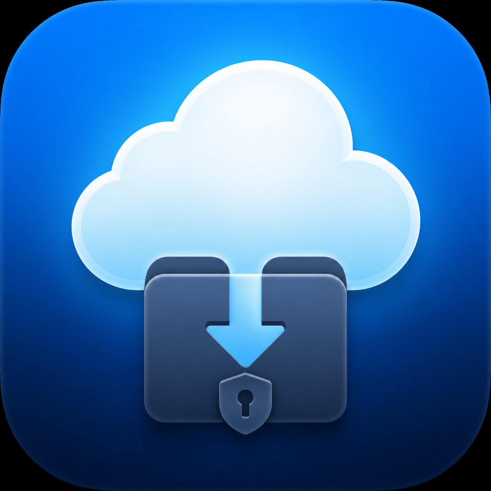
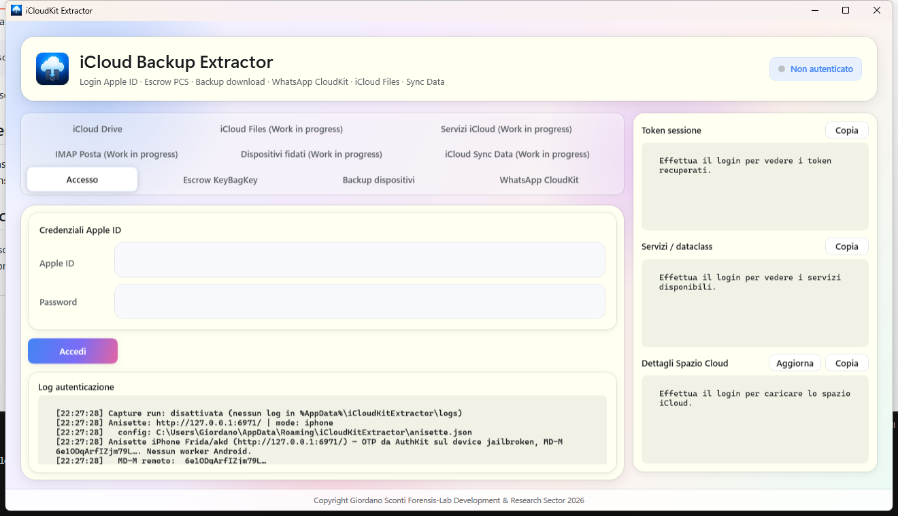
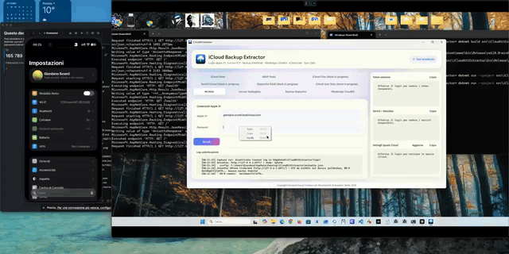
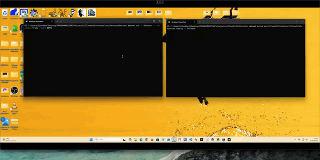
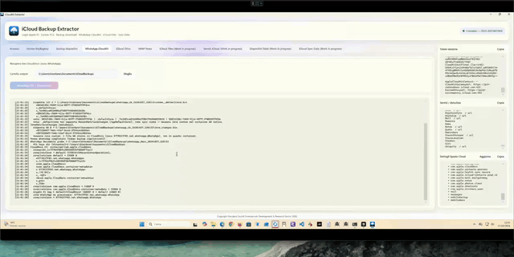
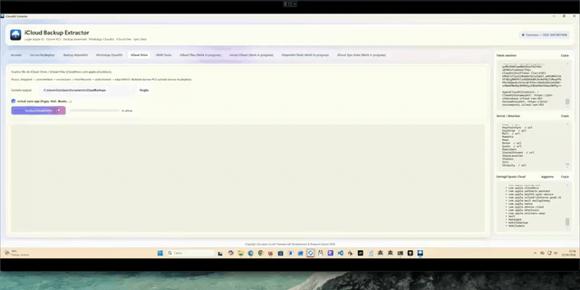
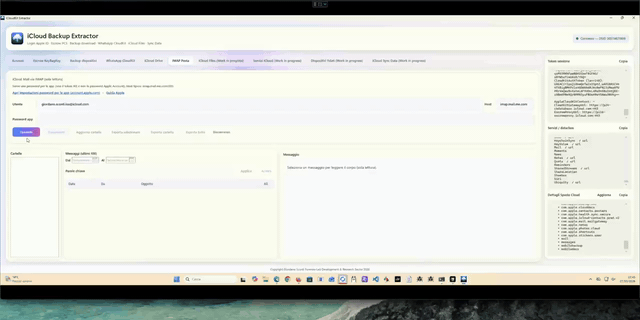
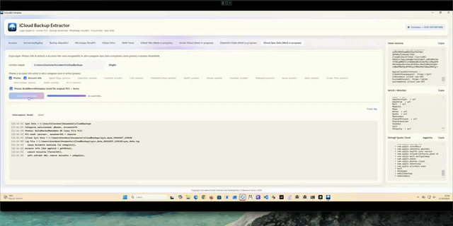

# iCloudKit Extractor

<p align="center">
  <a href="https://giordanosconti.github.io/iCloudKitExtractor/live/"></a>
  <a href="https://www.twitch.tv/d34dl0ck9327"></a>
</p>

<p align="center">
  <a href="https://giordanosconti.github.io/iCloudKitExtractor/live/"><strong>Live Session Offline</strong></a>
  · channel
  <a href="https://www.twitch.tv/d34dl0ck9327"><strong>Twitch · d34dl0ck9327</strong></a>
</p>

<p align="center">
  
</p>

<p align="center">
  <strong>WPF forensic lab tool</strong> for Apple ID sign-in, Escrow/PCS unlock, device backup download, and CloudKit data export — built on undocumented Apple protocols.<br/>
  <em>Public experimental phase · .NET 10 · Windows · MIT (© Giordano Sconti — use/collaboration grant to Forensis-Lab)</em>
</p>

<p align="center">
  <a href="https://github.com/GiordanoSconti/iCloudKitExtractor/releases/latest"></a>
  <a href="https://giordanosconti.github.io/iCloudKitExtractor/"></a>
  
  
  
  <a href="https://www.icloudkitextractor.eu"></a>
  
</p>

> [!IMPORTANT]
> **Anisette preview — ONLINE** · [https://www.icloudkitextractor.eu](https://www.icloudkitextractor.eu)  
> Leave the IKE **License** field empty on first connect to receive a Package-C license once.  
> **Multi-server:** the preview now runs on **multiple Tunnel replicas** (license rows sync through a Cloudflare Worker hub so any origin can validate your Package-C Bearer).  
> **11 Nov 2026:** brief connection / license errors were possible while that multi-replica sync was being rolled out — **service is fully restored**.  
> **VPN:** networks recognized as **institutions / universities** go through **manual operator consent** — access for later requests can be **allowed** or **denied**. Commercial / anonymous VPNs remain restricted under the acceptable-use rules in [Preview access](#preview-access-to-anisette-server).

<p align="center">
  
</p>

> **Research / lab software.** Not a finished product: undocumented Apple APIs, account-ban risk, no warranty. Use only with **your own** Apple ID and at your own risk.

---

## Why this exists

Commercial extractors often fail when **iCloud.com is off**, **ADP** is enabled, or **Lockdown Mode** is on. After ~**seven months** of protocol research, this tool completed **stable, full downloads** of personal backups with ADP both on and off (with the Octagon PIN or Recovery Key when required).

Built by **Giordano Sconti**, who works with **Forensis-Lab** — the author **holds possession** of this codebase and **grants Forensis-Lab use, collaboration, and representation** of the code (MIT to the public does not transfer that title). Released so extreme forensic recoveries of backups and CloudKit data remain possible when the only alternative is the physical device.

---

## What you can do

| Area | Capability |
|------|------------|
| **Access** | Apple ID login, HSA2 / trusted devices, Anisette OTP (Frida/akd preferred) |
| **Escrow & PCS** | EscrowProxy KeyBag / bottle PIN (HSM); or Recovery Key → Octagon TLKShares → Manatee/PCS (no Escrow RECOVER) |
| **Backup** | List device backups, MMCS download, iTunes-layout materialization |
| **WhatsApp** | CloudKit / CloudDocs document crypto path |
| **iCloud Drive** | Drive probe and file pull |
| **Mail** | IMAP export |
| **Sync Data** | Photos / Notes CloudKit sync paths + PhotosViewer payload |

> Several tabs still show *Work in progress* in the UI — the demos below show the flows that already run end-to-end in the lab.

**Download:** [latest experimental release](https://github.com/GiordanoSconti/iCloudKitExtractor/releases/latest) · **Site:** [GitHub Pages](https://giordanosconti.github.io/iCloudKitExtractor/)

---

## See it in action

Screen highlights (GIF). Same clips as MP4 under [`video/`](video/) if you prefer a sharper file.

### Login → Recovery Key (Octagon) → backup download

Sign in, unlock Octagon with a Recovery Key (Cuttlefish `fetchRecoverableTLKShares` → CKKS/Manatee — not EscrowProxy), then start a device backup pull.



[Highlight MP4](video/07-backup-login-download.mp4) · [Full recording (MP4, ~32 MB)](video/2026-10-28%2006-25-12.mp4)

### Device backups

Enumerate iCloud device backups and drive the CloudKit/MMCS download pipeline.



[MP4](video/01-backup-dispositivi.mp4)

### WhatsApp CloudKit

WhatsApp CloudKit / CloudDocs path — listing and crypto context for cloud-stored chats/docs.



[MP4](video/02-whatsapp-cloudkit.mp4)

### iCloud Drive

Browse and pull Drive content through the Drive probe service.



[MP4](video/03-icloud-drive.mp4)

### IMAP mail

Export mailbox content over IMAP from the authenticated session.



[MP4](video/04-imap-posta.mp4)

### iCloud Sync Data — Photos

Photos CloudKit sync: records, media metadata, and library-oriented export.



[MP4](video/05-icloud-sync-photos.mp4)

---

## Real backup run

Screenshots from a live personal backup download (ADP / Escrow path).

<p align="center">
  
</p>

<p align="center">
  
</p>

### When commercial tools stop

Same account conditions where **Elcomsoft 11.0.5** returned *Access Denied* with **iCloud.com off** and **ADP enabled** — IKE continued the Escrow/Octagon path:

<p align="center">
  
</p>

---

## Recovery Key & Octagon

Recovery Key unlock is an **Octagon / Cuttlefish** path, **not** EscrowProxy `RECOVER` / HSM bottle unlock (that path still needs the device Octagon PIN).

Flow in short:

1. **Login** — session tokens plus `altDSID` (HKDF salt).
2. **Derive the RK peer** — `HKDF-SHA384(RK, altDSID)` → P-384 signing + encryption keys; peer ID = `RK-` + Base64(SHA-384 of the **signing public key** derived from the Recovery Key).
3. **`ckAppInit`** on `com.apple.security.keychain`, then **`fetchRecoverableTLKShares(forPeer=RK-…)`** — encrypted TLKShares **scoped to that peer**.
4. **ECIES unwrap** with the RK encryption private key → TLKs for views such as Manatee / ProtectedCloudStorage / Passwords.
5. **CKKS OpenVault** → Manatee/PCS KeySet for CloudKit zones, including **ADP-protected backups** and **Keychain**.

**`forPeer` empty:** if the Cuttlefish call omits / sends an empty `forPeer`, the API returns the **full set of recoverable encrypted TLKShares** (all peers), not only those addressed to one `RK-…`. The normal Recovery Key unlock still passes `forPeer=RK-…`; empty `forPeer` is useful for dumping / inventory. Shares remain ECIES-wrapped — you can unwrap only the ones whose receiver keys you hold.

You can also verify offline whether a given Recovery Key matches harvested `RK-…` peer IDs and unwrap recoverable share dumps the same way.

## iCDP records (Octagon bottles)

Octagon trust for ADP / Manatee / PCS often rests on **iCDP bottles**: Escrowproxy Secure Backup rows labeled `com.apple.icdp.record.*`. Each row is tied to a device that previously joined the circle (serial, build, remaining HSM tries). Listing bottles (`get_records`) is **non-destructive**. Recovering a bottle against the HSM is **not**.

Lab diary: [Day 9 — bottles, iCDP, trusted-device PIN](https://giordanosconti.github.io/iCloudKitExtractor/blog/posts/2026-10-05-day-09-octagon-bottles-icdp.html) · [Day 10 — Recovery Key / TLKShares](https://giordanosconti.github.io/iCloudKitExtractor/blog/posts/2026-10-24-day-10-recovery-key-tlkshares.html).

### Unlocking with a device PIN (iCSC / passcode)

1. Sign in to IKE so the session has PET / tokens.
2. **List iCDP bottles**, then **Unlock Octagon bottle** with the **passcode of that trusted device** (not the Apple ID password, not the old PCS `dsid:dsid` secret).
3. Escrowproxy `SRP_INIT` / `RECOVER` unwraps the EscrowBottle → **BottledPeerEntropy** (~72 bytes).
4. Cuttlefish `fetchViableBottles` returns **OTBottle Contents**; AES-GCM with that entropy yields the peer signing/encryption keys → KeySet / vault path.

**Credential at bottle creation time:** the PIN / device passcode (and, where applicable, the Apple ID password or Recovery Key used to bind that escrow row) is the one that was in force **when that iCDP record was created**. If the device passcode, Apple ID password, or Recovery Key was **changed later** and the bottle was **never re-created** (e.g. no Sign out → Sign in that minted a new `com.apple.icdp.record.*`), you must still use the **old** credential from creation time — **not** the current one. A new PIN/password only unlocks bottles minted **after** that change.

**HSM caution:** each wrong PIN burns an attempt on that record (on the order of **~10** tries). IKE treats recover as irreversible and expects an explicit confirm. Prefer the correct device PIN; do not brute-force production bottles.

### Unlocking with a Recovery Key (when the PIN path is unavailable)

If you do not have a usable bottle PIN (lost device, exhausted attempts, bottle not viable), use the **Recovery Key → Octagon peer → `fetchRecoverableTLKShares` → OpenVault** path described in [Recovery Key & Octagon](#recovery-key--octagon). That does **not** replace Escrowproxy `RECOVER` on an iCDP label; it opens the same class of vault material through recoverable TLKShares addressed to the RK peer. The same creation-time rule applies: use the Recovery Key that was active when the recoverable shares / circle binding were established, not a key rotated afterward unless Octagon was re-enrolled with the new key.

### Orphan iCDP records (no OTBottle Contents)

`fetchViableBottles` can still list bottle **metadata** (labels, serials, peer ids) while **Contents** is empty or missing. In IKE those show up as viable/partial rows with `contents=0 B`.

Such records are **orphans for peer-key recovery**: Escrow unlock may still produce entropy for an old Escrow row, but there is **no OTBottle ciphertext** to AES-GCM-open into signing/encryption keys. Trying every bottle then fails with GCM / “no Contents” style errors. Those stubs are **no longer useful** for the KeySet path; keep them for inventory only, and unlock a different bottle that still has Contents—or use Recovery Key if available.

Typical lab situations: device left the circle long ago, bottle was retired after circle changes, or Escrow and Cuttlefish views are out of sync (Escrow label present, OTBottle payload gone).

### Recreating a usable bottle (Sign out → Sign in on the device)

To mint a **fresh** iCDP / Octagon bottle for a specific device you control:

1. On that device, open **Settings → [your name]** (or System Settings on Mac).
2. **Sign out** of the Apple ID (iCloud). Confirm you understand local iCloud data handling prompts for that device.
3. **Sign in** again with the same Apple ID, complete any 2FA / device trust steps, and wait until iCloud / Keychain / backup sync settle.
4. The device re-joins Octagon and Escrow can publish a **new** `com.apple.icdp.record.*` bottle with recoverable Contents.
5. In IKE: sign in again, **refresh the bottle list**, unlock with that device’s **current passcode**, then continue with peer keys / OpenVault / backup as usual.

This is an **account + device** operation on hardware you are authorized to use—not something IKE can fabricate server-side. Prefer Recovery Key when the goal is only vault access and a healthy RK exists; use Sign out / Sign in when you need a **new PIN-bound bottle** for that device.

---

## Quick start

**Needs:** [.NET 10 SDK](https://dotnet.microsoft.com/download) · a physical Anisette source (emulated stacks are no longer reliable) · an Apple ID **you** control.

- **Build & run** (Windows WPF / macOS Avalonia + Anisette): see **[How to Build](#how-to-build)** below.
- Or grab a signed build from [Releases](https://github.com/GiordanoSconti/iCloudKitExtractor/releases). Each release notes the **SHA-256** of the zip archives (also as `HASHES.sha256`); verify with `Get-FileHash -Algorithm SHA256` (Windows) or `shasum -a 256` (macOS).

### Preview access to Anisette Server

Temporary public preview endpoint (leave the IKE **License** field empty on first connect to receive a Package-C license once):

**https://www.icloudkitextractor.eu**

> **Status — currently active and running (fully restored).** Published via **Cloudflare Tunnel** with **multiple origin replicas** (see below). Prefer self-host or contact for access if the preview is temporarily down.

> **Multi-server (Nov 2026).** The same public hostname can be served by more than one lab machine behind Cloudflare. Package-C licenses are synchronized through a small **Cloudflare Worker + KV** hub so a Bearer issued on one replica validates on the others. On **11 November 2026**, short-lived connection or `license_id not registered` errors may have occurred while that work was deploying — **the service is fully operational again**.

> **Note — VPN / institutional access.** A **manual authorization** flow was added for VPNs recognized as institutions / universities: when such a network is detected, the operator can **allow** controlled access for subsequent requests or **deny** it. Commercial / anonymous VPNs remain subject to the acceptable-use rules below.

#### How the preview is published (Cloudflare Tunnel)

The lab middleware (**Anisette Middleware** / `AnisetteServer.Mac` Avalonia app — **Windows and macOS** — or headless Licensed) listens locally on **HTTP** `:6971` (`http://127.0.0.1:6971` / `http://0.0.0.0:6971`). A small **`cloudflared`** agent on each replica opens an **outbound-only** tunnel to Cloudflare. Clients hit a public HTTPS hostname; Cloudflare terminates TLS and forwards into a healthy replica. **No router port forward, UPnP, or public IP** is required — this also works behind CGNAT (e.g. many Vodafone Station / FWA setups).

```
IKE / curl  →  https://www.icloudkitextractor.eu[…]  →  Cloudflare edge
                                    ┌──────────────────┴──────────────────┐
                                    ↕ tunnel                    ↕ tunnel
                              cloudflared (replica A)     cloudflared (replica B)
                                    ↓                            ↓
                           http://127.0.0.1:6971          http://127.0.0.1:6971
                           (Anisette Middleware)         (Anisette Middleware)
                                    └──────── Worker/KV license hub ────────┘
```

Self-host tip (same pattern as the preview): keep Anisette on local HTTP, point a Cloudflare Tunnel ingress hostname at `http://127.0.0.1:6971`, then set IKE `ANISETTE_SERVER_URL` to your `https://…` hostname. Details: [Cloudflare Tunnel docs](https://developers.cloudflare.com/cloudflare-one/connections/connect-apps/). Licensed stack: [docs/ANISETTE_LICENSED.md](docs/ANISETTE_LICENSED.md).

> **Disclaimer — licensing telemetry & acceptable use**  
> To issue and bind temporary licenses on **my** preview server, the remote client **IP address** and other request-linked identifiers (machine fingerprint headers used by Package-C) are collected so the license stays tied to that connection profile. I may **revoke** a license if the preview service is abused for unauthorized or non-consensual attacks. This software is made available for **ethical and forensic** use only.  
> If VPNs (or similar) are used to exploit my server for attacks of any kind, I will **stop offering preview access** through my Anisette endpoint.  
> I hope there are still people in the world with a sound intellect.

Want longer-term or private access? Contact: [giordano.sconti@gruppoinformaticiforensi.it](mailto:giordano.sconti@gruppoinformaticiforensi.it) · [giordano.sconti@gmail.com](mailto:giordano.sconti@gmail.com). Prefer hosting your own stack: [docs/ANISETTE_LICENSED.md](docs/ANISETTE_LICENSED.md) (Desktop middleware / Licensed default is plain **HTTP** `:6971`; optional HTTPS via `https://…` listen URLs or `ANISETTE_TLS_ENABLE=1`).

### Preferred Anisette: Frida on a jailbroken iPhone

OTP minted on-device via Frida → AuthKit/`akd`, then served by `AnisetteServer`.

#### 1. Prerequisites (device + PC)

- Jailbroken iPhone with **frida-server** running (USB or Wi‑Fi)
- Matching **frida-tools** version on the PC (`pip install frida-tools`)
- Python 3 available as `python` (or set `FRIDA_ANISETTE_PYTHON`)
- Bundled Frida scripts under `scripts/ios_akd_probe/` (`fetch_anisette.py` + JS). Copied next to AnisetteServer as `ios_akd_probe/` on build/publish. Optional override: `FRIDA_ANISETTE_FETCH_PY` (file or that directory)

> Jailbreak install steps: see **[Preparing a jailbroken iPhone](#preparing-a-jailbroken-iphone)** below.

#### 2. Environment variables

| Variable | Required | Default | Meaning |
|----------|----------|---------|---------|
| `ANISETTE_SERVER_BACKEND` | **yes** | `coreadi` | Must be `frida` (aliases: `iphone-frida`, `jb-frida`) |
| `ANISETTE_SERVER_URL` / `ANISETTE_SERVER_URLS` | no | `http://127.0.0.1:6969` | URL(s) where AnisetteServer listens |
| `ANISETTE_SERVER_PORT` | no | `6969` | Port if URLs not set |
| `ICLOUD_AUTH_MODE` | recommended | `iphone` (via config) | Use `iphone` for full AuthKit iPhone SRP |
| `FRIDA_ANISETTE_HOST` | no | `127.0.0.1:27042` | frida-server host:port (USB often via `iproxy 27042 27042`) |
| `FRIDA_ANISETTE_PROCESS` | no | `akd` | Process to attach |
| `FRIDA_ANISETTE_FETCH_PY` | no | `ios_akd_probe/` next to exe | Path to `fetch_anisette.py` **or** to the `ios_akd_probe` directory |
| `FRIDA_ANISETTE_PYTHON` | no | `python` | Python executable |
| `FRIDA_ANISETTE_LITE` | no | `1` / true | Lite attach mode |
| `FRIDA_ANISETTE_TIMEOUT` | no | `60` | Seconds before aborting a mint |

Optional app config file: `%AppData%\iCloudKitExtractor\anisette.json` (`authMode`, `serverUrl`). Env vars override the file.

#### 3. Start Anisette + IKE

Build/run commands (Frida env, AnisetteServer / Anisette Middleware, iCloudKitExtractor) live in **[How to Build](#how-to-build)** — Windows and macOS are listed separately.

Smoke test once Anisette is up:

```bash
curl http://127.0.0.1:6971/health
curl http://127.0.0.1:6971/
```

Expect JSON with machine data (`X-Apple-I-MD-M`, `X-MMe-Client-Info` containing `com.apple.akd`).

## How to Build

Prerequisites for both platforms: [.NET 10 SDK](https://dotnet.microsoft.com/download), repo cloned locally, and (for Frida Anisette) a jailbroken iPhone with frida-server — see [Preparing a jailbroken iPhone](#preparing-a-jailbroken-iphone) and [Preferred Anisette](#preferred-anisette-frida-on-a-jailbroken-iphone).

Shared library: `src/iCloudKitExtractor.Core` (`net10.0`). UI clients:

| OS | Anisette | iCloudKit Extractor |
|----|----------|---------------------|
| **Windows** | `AnisetteServer` (console Frida) and/or `AnisetteServer.Mac` → **AnisetteMiddleware** (Avalonia) | `iCloudKitExtractor` (WPF, `net10.0-windows`) |
| **macOS** | Same: `AnisetteServer` (console Frida) and/or `AnisetteServer.Mac` → **AnisetteMiddleware** (Avalonia; preferred when you want UI / Package-C / NAC relay) | `iCloudKitExtractor.Desktop` (Avalonia, `net10.0`) |

Default local Anisette URL used below: `http://127.0.0.1:6971`.

`AnisetteServer` is **not** Windows-only (`net10.0`). On Mac the Middleware is usually preferred for daily use; the console Frida server is still valid for a minimal local OTP gate.

### Windows

#### AnisetteServer (console, Frida)

```powershell
$env:ANISETTE_SERVER_BACKEND = "frida"
$env:ANISETTE_SERVER_PORT = "6971"
$env:FRIDA_ANISETTE_HOST = "127.0.0.1:27042"
$env:FRIDA_ANISETTE_PROCESS = "akd"
# Optional — defaults to bundled scripts/ios_akd_probe (copied beside the exe)
# $env:FRIDA_ANISETTE_FETCH_PY = "C:\path\to\scripts\ios_akd_probe"
$env:FRIDA_ANISETTE_PYTHON = "python"
$env:FRIDA_ANISETTE_LITE = "1"
$env:FRIDA_ANISETTE_TIMEOUT = "60"

dotnet build src/AnisetteServer/AnisetteServer.csproj -c Release
dotnet run --project src/AnisetteServer/AnisetteServer.csproj -c Release -- --backend frida --port 6971
```

CLI `--backend` / `--port` override the environment.

#### Anisette Middleware (Avalonia UI — Windows)

```powershell
dotnet build src/AnisetteServer.Mac/AnisetteServer.Mac.csproj -c Release
dotnet run --project src/AnisetteServer.Mac/AnisetteServer.Mac.csproj -c Release
```

Publish example:

```powershell
dotnet publish src/AnisetteServer.Mac/AnisetteServer.Mac.csproj -c Release -r win-x64 --self-contained false
```

#### iCloudKit Extractor (WPF)

With Anisette already listening on `:6971`:

```powershell
$env:ANISETTE_SERVER_URL = "http://127.0.0.1:6971/"
$env:ICLOUD_AUTH_MODE = "iphone"

dotnet build src/iCloudKitExtractor/iCloudKitExtractor.csproj -c Release
dotnet run --project src/iCloudKitExtractor/iCloudKitExtractor.csproj -c Release
```

WPF targets `net10.0-windows` — build this project on Windows (or with Windows targeting packs). Optional Anisette settings file: `%AppData%\iCloudKitExtractor\anisette.json`.

### macOS

#### AnisetteServer (console, Frida)

Same project as on Windows — builds and runs on macOS:

```bash
export ANISETTE_SERVER_BACKEND=frida
export ANISETTE_SERVER_PORT=6971
export FRIDA_ANISETTE_HOST=127.0.0.1:27042
export FRIDA_ANISETTE_PROCESS=akd
export FRIDA_ANISETTE_PYTHON=python3
export FRIDA_ANISETTE_LITE=1
export FRIDA_ANISETTE_TIMEOUT=60

dotnet build src/AnisetteServer/AnisetteServer.csproj -c Release
dotnet run --project src/AnisetteServer/AnisetteServer.csproj -c Release -- --backend frida --port 6971
```

#### Anisette Middleware (Avalonia UI)

Preferred on Mac when you want the desktop panel (license admin, Start/Stop, NAC relay). Same binary name **AnisetteMiddleware**:

```bash
export ANISETTE_SERVER_BACKEND=frida
export ANISETTE_SERVER_PORT=6971
export FRIDA_ANISETTE_HOST=127.0.0.1:27042
export FRIDA_ANISETTE_PROCESS=akd
export FRIDA_ANISETTE_PYTHON=python3
export FRIDA_ANISETTE_LITE=1
export FRIDA_ANISETTE_TIMEOUT=60

dotnet build src/AnisetteServer.Mac/AnisetteServer.Mac.csproj -c Release
dotnet run --project src/AnisetteServer.Mac/AnisetteServer.Mac.csproj -c Release
```

Headless middleware (no UI):

```bash
dotnet run --project src/AnisetteServer.Mac/AnisetteServer.Mac.csproj -c Release -- --headless
```

Publish example (Apple Silicon):

```bash
dotnet publish src/AnisetteServer.Mac/AnisetteServer.Mac.csproj -c Release -r osx-arm64 --self-contained false
```

More detail: [src/AnisetteServer.Mac/README.md](src/AnisetteServer.Mac/README.md) · [docs/ANISETTE_LICENSED.md](docs/ANISETTE_LICENSED.md).

#### iCloudKit Extractor (Avalonia Desktop)

WPF does **not** run on macOS. Use the Avalonia client:

```bash
export ANISETTE_SERVER_URL=http://127.0.0.1:6971/
export ICLOUD_AUTH_MODE=iphone
# Optional NAC relay (same Mac Mini middleware): IKE_NAC_RELAY_URL or derive from Anisette URL

dotnet build src/iCloudKitExtractor.Core/iCloudKitExtractor.Core.csproj -c Release
dotnet build src/iCloudKitExtractor.Desktop/iCloudKitExtractor.Desktop.csproj -c Release
dotnet run --project src/iCloudKitExtractor.Desktop/iCloudKitExtractor.Desktop.csproj -c Release
```

Optional Anisette settings: `~/Library/Application Support/iCloudKitExtractor/anisette.json` (same schema as Windows). Default Anisette on macOS is local `http://127.0.0.1:6971`.

## Preparing a jailbroken iPhone

Install **Frida** (frida-server) and **OpenSSH** from **Sileo** on the device first.

Assumes a **rootless** jailbreak (`/var/jb/...`). Over SSH as **root**:

```sh
ls -l /var/jb/usr/sbin/frida-server
```

Recreate the LaunchDaemon plist (LF endings, rootless)—no editor needed:

```sh
cat > /var/jb/Library/LaunchDaemons/re.frida.server.plist <<'EOF'
<?xml version="1.0" encoding="UTF-8"?>
<!DOCTYPE plist PUBLIC "-//Apple//DTD PLIST 1.0//EN" "http://www.apple.com/DTDs/PropertyList-1.0.dtd">
<plist version="1.0">
<dict>
	<key>Label</key>
	<string>re.frida.server</string>
	<key>ProgramArguments</key>
	<array>
		<string>/var/jb/usr/sbin/frida-server</string>
		<string>-l</string>
		<string>0.0.0.0:27042</string>
	</array>
	<key>RunAtLoad</key>
	<true/>
	<key>KeepAlive</key>
	<true/>
	<key>ThrottleInterval</key>
	<integer>3</integer>
</dict>
</plist>
EOF
```

Normalize line endings, convert the plist to binary, then (re)load the daemon:

```sh
tr -d '\r' < /var/jb/Library/LaunchDaemons/re.frida.server.plist > /tmp/frida.plist
mv /tmp/frida.plist /var/jb/Library/LaunchDaemons/re.frida.server.plist
plutil -convert binary1 /var/jb/Library/LaunchDaemons/re.frida.server.plist
killall frida-server 2>/dev/null
launchctl bootout system /var/jb/Library/LaunchDaemons/re.frida.server.plist 2>/dev/null
launchctl bootstrap system /var/jb/Library/LaunchDaemons/re.frida.server.plist
launchctl enable system/re.frida.server
launchctl kickstart -k system/re.frida.server
ps aux | grep '[f]rida-server'
```

This binds **frida-server** on `0.0.0.0:27042` (all interfaces), starts at boot, and keeps it alive. From the PC set e.g. `FRIDA_ANISETTE_HOST=127.0.0.1:27042` after USB port-forward (`iproxy 27042 27042`) or use the device LAN IP.

## Host a licensed remote Anisette

If you want others to use **your** Frida/iPhone OTP over the network, run the licensed middleware (Package-C licenses, empty DB until you issue or auto-issue):

| Project | Role |
|---------|------|
| `AnisetteServer.Mac` → **AnisetteMiddleware** | Avalonia UI for **Windows & macOS**: Frida IP, Start/Stop, license admin |
| `AnisetteServer.Licensed` | Headless HTTP gate + Bearer / first-connection auto-issue |
| `AnisetteLicenseGen` | `init-keys`, issue / disable / enable / revoke |

Full guide: **[docs/ANISETTE_LICENSED.md](docs/ANISETTE_LICENSED.md)**. Keep your `keys/` and issued licenses private.

## Other anisette backends

| Backend | Use case | Docs |
|---------|----------|------|
| `frida` | Real iPhone/akd OTP (recommended) | This README |
| Licensed remote | Self-host gate + Package-C licenses | [docs/ANISETTE_LICENSED.md](docs/ANISETTE_LICENSED.md) |
| `akd-emulated` | Software ADI worker | [docs/EMULATED_AKD.md](docs/EMULATED_AKD.md) |
| `coreadi` | Windows CoreADI / AuthKitWin hybrid | [docs/MAC_ANISETTE.md](docs/MAC_ANISETTE.md) |
| Mac Docker + bridge | CGNAT / remote Mac anisette | [docs/ANISETTE_BRIDGE.md](docs/ANISETTE_BRIDGE.md) |

```powershell
.\scripts\setup-emulated-akd.ps1
```

Also: [docs/IPHONE_INTERNAL_FLOW.md](docs/IPHONE_INTERNAL_FLOW.md) · [docs/APPLE_MIDSERVICE_PROVISIONING.md](docs/APPLE_MIDSERVICE_PROVISIONING.md)

### Research notes (GitHub Pages)

Lab diary entries under [Notes](https://giordanosconti.github.io/iCloudKitExtractor/blog/):

- [Code symbol navigation](https://giordanosconti.github.io/iCloudKitExtractor/blog/posts/2026-11-05-code-symbol-navigation.html) — Auth, CloudKit Lock, MMCS, Ford/LiveFill, Escrow/Octagon, and session models with paths, kinds, descriptions, and a call-flow sketch.
- [Inside MMCS and authorizeGet: a code map](https://giordanosconti.github.io/iCloudKitExtractor/blog/posts/2026-11-05-mmcs-authorizeget-code-map.html) — Lock → `x-apple-mmcs-auth` → authorizeGet / FileGroups → edge ranged GET → IKM / `PCSMMCS2` → Ford & ChunkInfo, mapped to the types in this tree.
- [Themida, x64dbg MCP, and Frida on `memcpy`](https://giordanosconti.github.io/iCloudKitExtractor/blog/posts/2026-11-05-themida-x64dbg-mcp-frida-memcpy.html) — how virtualized/mutated code and VC++ `memcpy` hooks sped up early HTTPS capture work in the lab. For modern code virtualization / obfuscation as a protection map we used the master’s thesis PDF ([Masters Thesis.pdf](https://github.com/67-6f-64/AntiOreans-CodeDevirtualizer/blob/main/Masters%20Thesis.pdf) in [67-6f-64/AntiOreans-CodeDevirtualizer](https://github.com/67-6f-64/AntiOreans-CodeDevirtualizer)), not the accompanying code tool.

---

## Repository layout

| Path | Role |
|------|------|
| `src/iCloudKitExtractor.Core` | Shared services / models / protocol (`net10.0`) |
| `src/iCloudKitExtractor` | Main WPF app (**Windows**) |
| `src/iCloudKitExtractor.Desktop` | Avalonia UI (**macOS** / also runnable on Windows) |
| `src/PhotosViewer` | Photo library viewer (copied into `viewer-payload` on IKE build) |
| `src/AnisetteServer` | OTP / ADI server (unsigned, local; typical on Windows) |
| `src/AnisetteServer.Licensed` | Licensed HTTP gate (self-host) |
| `src/AnisetteServer.Mac` | Avalonia Frida middleware + license panel (**Windows / macOS**; binary `AnisetteMiddleware`) |
| `src/AnisetteLicense` / `AnisetteLicenseGen` | Package-C crypto + CLI |
| `scripts/` | Emulated akd / bridge / Frida helpers |
| `docs/` | Protocol notes + [GitHub Pages](https://giordanosconti.github.io/iCloudKitExtractor/) site |
| `video/` | Demo GIF + MP4 highlights |
| `img/` | Backup / comparison screenshots |

Lab probes, capture corpora, and private tooling stay out of this public tree.

---

## About & contact

**Giordano Sconti** — software researcher and technical consultant (Consulente Tecnico), working with **Forensis-Lab**.

This software is **by Giordano Sconti**. He **holds possession** of the codebase and **grants Forensis-Lab use, collaboration, and representation** of these lines of code. That grant does **not** assign ownership away from the author; Forensis-Lab may represent and work with the code under that concession. The public **MIT** license likewise grants permission to use and collaborate under the copyright notice — it is **not** a transfer of title. Contributors do not become co-owners by submitting a PR; accepted contributions are licensed back under the same terms, with authorship credited.

Apple’s internal APIs can change overnight — treat every build as experimental.

Contributions, careful PRs, and feedback are welcome. Prefer paid coding-agent models if you use them, **always review** generated code, and do not appropriate third-party code without consent. PRs are reviewed carefully.

Community docs: [Code of Conduct](CODE_OF_CONDUCT.md) · [Contributing](CONTRIBUTING.md) · [Security policy](SECURITY.md)

**Email:** [giordano.sconti@gruppoinformaticiforensi.it](mailto:giordano.sconti@gruppoinformaticiforensi.it) · [giordano.sconti@gmail.com](mailto:giordano.sconti@gmail.com)

If you want to buy a coffee, thank **Forensis-Lab** or another form of recognition instead.

Keep the copyright notice and attribution (**Giordano Sconti** / Forensis-Lab representation) on every copy or substantial portion you use or redistribute.

---

## License & disclaimer

**MIT** — see [`LICENSE`](LICENSE).

Third-party package licenses and protocol-reference projects (clean-room; not vendored): [`NOTICE.md`](NOTICE.md).

Copyright © **Giordano Sconti**. Possession of the code remains with the author, who grants **Forensis-Lab** use, collaboration, and representation rights. Recipients under MIT receive a **license to use and collaborate**, not ownership. The MIT grant is permission to deal in the Software under the copyright conditions — **not** an assignment of rights.

This software talks to Apple services in unofficial ways. Endpoints may change at any time. The authors are not responsible for data loss, account suspension, or other damages.
