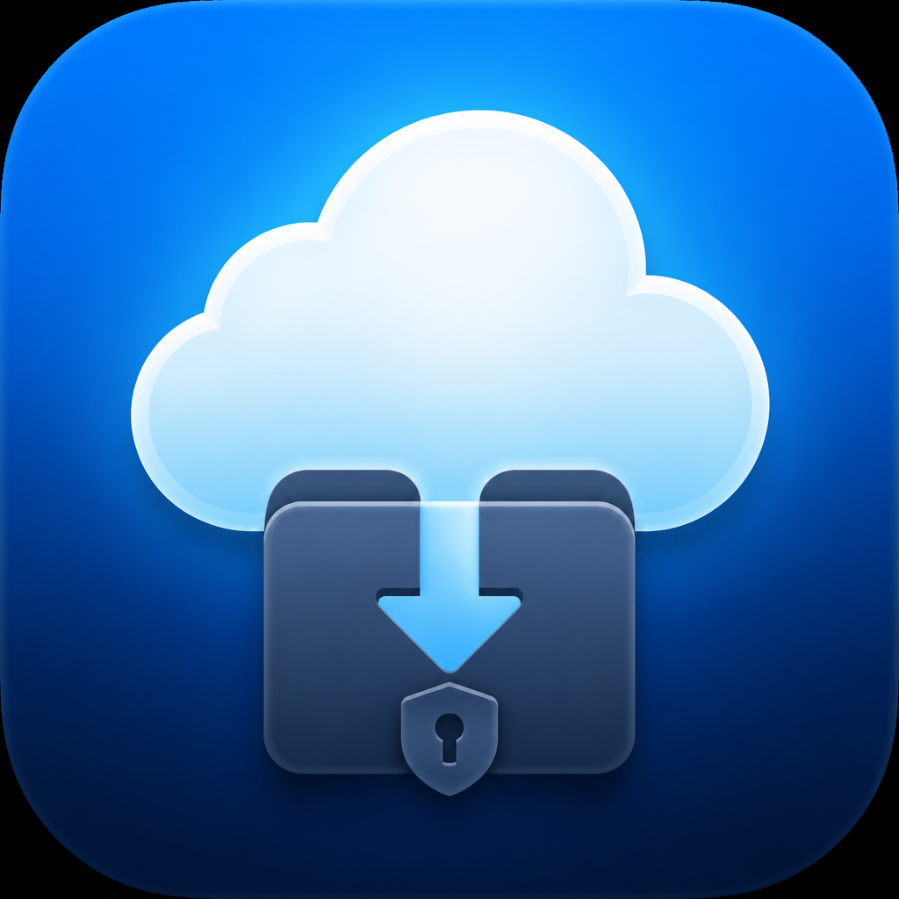
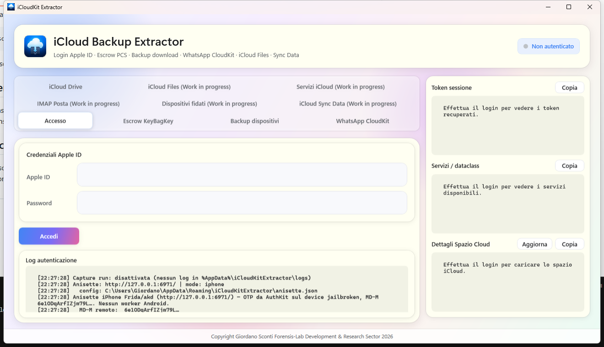
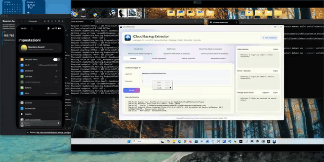
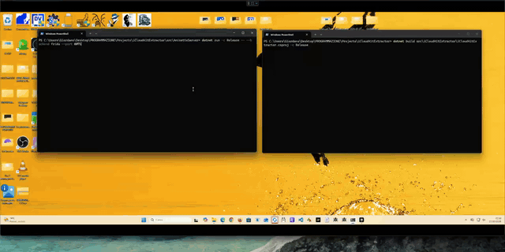
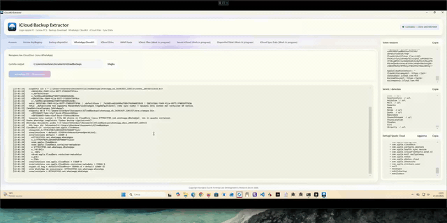
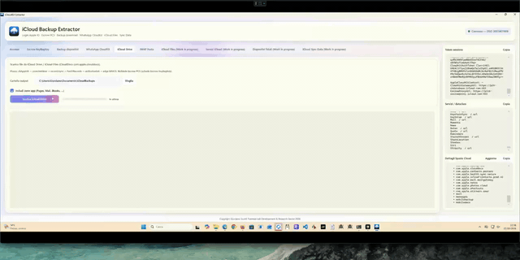
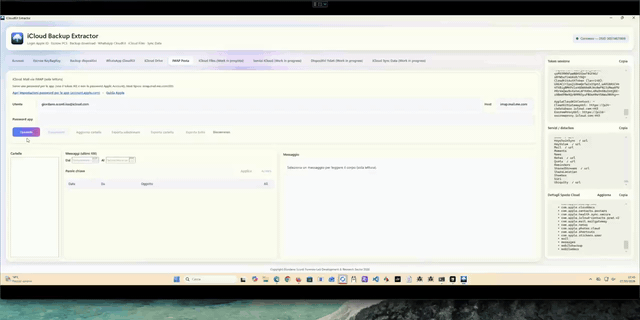
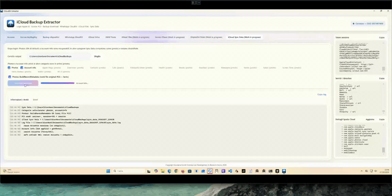

# iCloudKit Extractor

<p align="center">
  
</p>

<p align="center">
  <strong>WPF forensic lab tool</strong> for Apple ID sign-in, Escrow/PCS unlock, device backup download, and CloudKit data export — built on undocumented Apple protocols.<br/>
  <em>Public experimental phase · .NET 10 · Windows · MIT (Forensis-Lab)</em>
</p>

<p align="center">
  <a href="https://github.com/GiordanoSconti/iCloudKitExtractor/releases/latest"></a>
  <a href="https://giordanosconti.github.io/iCloudKitExtractor/"></a>
  
  
  
</p>

<p align="center">
  
</p>

> **Research / lab software.** Not a finished product: undocumented Apple APIs, account-ban risk, no warranty. Use only with **your own** Apple ID and at your own risk.

---

## Why this exists

Commercial extractors often fail when **iCloud.com is off**, **ADP** is enabled, or **Lockdown Mode** is on. After ~**seven months** of protocol research, this tool completed **stable, full downloads** of personal backups with ADP both on and off (with the Octagon PIN or Recovery Key when required).

Built by **Giordano Sconti** with **[Forensis-Lab](https://giordanosconti.github.io/iCloudKitExtractor/)** — released so extreme forensic recoveries of backups and CloudKit data remain possible when the only alternative is the physical device.

---

## What you can do

| Area | Capability |
|------|------------|
| **Access** | Apple ID login, HSA2 / trusted devices, Anisette OTP (Frida/akd preferred) |
| **Escrow & PCS** | KeyBag / bottle unlock, Recovery Key → TLKShares, Manatee keysets |
| **Backup** | List device backups, MMCS download, iTunes-layout materialization |
| **WhatsApp** | CloudKit / CloudDocs document crypto path |
| **iCloud Drive** | Drive probe and file pull |
| **Mail** | IMAP export |
| **Sync Data** | Photos / Notes CloudKit sync paths + PhotosViewer payload |

> Several tabs still show *Work in progress* in the UI — the demos below show the flows that already run end-to-end in the lab.

**Download:** [latest experimental release](https://github.com/GiordanoSconti/iCloudKitExtractor/releases/latest) · **Site:** [GitHub Pages](https://giordanosconti.github.io/iCloudKitExtractor/)

---

## See it in action

Screen highlights (GIF). Same clips as MP4 under [`video/`](video/) if you prefer a sharper file.

### Recovery Key → login → backup download

Sign in, unlock Escrow with a Recovery Key, then start a device backup pull.



[Highlight MP4](video/07-backup-login-download.mp4) · [Full recording (MP4, ~32 MB)](video/2026-10-28%2006-25-12.mp4)

### Device backups

Enumerate iCloud device backups and drive the CloudKit/MMCS download pipeline.



[MP4](video/01-backup-dispositivi.mp4)

### WhatsApp CloudKit

WhatsApp CloudKit / CloudDocs path — listing and crypto context for cloud-stored chats/docs.



[MP4](video/02-whatsapp-cloudkit.mp4)

### iCloud Drive

Browse and pull Drive content through the Drive probe service.



[MP4](video/03-icloud-drive.mp4)

### IMAP mail

Export mailbox content over IMAP from the authenticated session.



[MP4](video/04-imap-posta.mp4)

### iCloud Sync Data — Photos

Photos CloudKit sync: records, media metadata, and library-oriented export.



[MP4](video/05-icloud-sync-photos.mp4)

---

## Real backup run

Screenshots from a live personal backup download (ADP / Escrow path).

<p align="center">
  
</p>

<p align="center">
  
</p>

### When commercial tools stop

Same account conditions where **Elcomsoft 11.0.5** returned *Access Denied* with **iCloud.com off** and **ADP enabled** — IKE continued the Escrow/Octagon path:

<p align="center">
  
</p>

---

## Recovery Key & Octagon

Recovery Key unlock hits an **Octagon** endpoint that can dump the full set of **encrypted TLKShares**. From those shares you can recover the ones tied to Recovery Key peers (SHA-384 of the public key that signs the Recovery Key), verify whether a given Recovery Key is present, and — if it is — recover the Manatee/PCS KeySet for CloudKit zones, including **ADP-protected backups** and **Keychain**.

---

## Quick start

**Needs:** Windows · [.NET 10 SDK](https://dotnet.microsoft.com/download) · a physical Anisette source (emulated stacks are no longer reliable) · an Apple ID **you** control.

```powershell
dotnet build src/iCloudKitExtractor/iCloudKitExtractor.csproj -c Release
dotnet run --project src/iCloudKitExtractor/iCloudKitExtractor.csproj -c Release
```

Or grab a signed build from [Releases](https://github.com/GiordanoSconti/iCloudKitExtractor/releases).

### Preview access to Anisette Server

Temporary public preview endpoint (leave the IKE **License** field empty on first connect to receive a Package-C license once):

**https://www.icloudkitextractor.eu:6971**

> **Disclaimer — licensing telemetry & acceptable use**  
> To issue and bind temporary licenses on **my** preview server, the remote client **IP address** and other request-linked identifiers (machine fingerprint headers used by Package-C) are collected so the license stays tied to that connection profile. I may **revoke** a license if the preview service is abused for unauthorized or non-consensual attacks. This software is made available for **ethical and forensic** use only.  
> If VPNs (or similar) are used to exploit my server for attacks of any kind, I will **stop offering preview access** through my Anisette endpoint.  
> I hope there are still people in the world with a sound intellect.

Want longer-term or private access? Contact: [giordano.sconti@gruppoinformaticiforensi.it](mailto:giordano.sconti@gruppoinformaticiforensi.it). Prefer hosting your own stack: [docs/ANISETTE_LICENSED.md](docs/ANISETTE_LICENSED.md) (Mac/Licensed default is plain **HTTP** `:6971`; optional HTTPS via `https://…` listen URLs or `ANISETTE_TLS_ENABLE=1`).

### Preferred Anisette: Frida on a jailbroken iPhone

OTP minted on-device via Frida → AuthKit/`akd`, then served by `AnisetteServer`.

#### 1. Prerequisites (device + PC)

- Jailbroken iPhone with **frida-server** running (USB or Wi‑Fi)
- Matching **frida-tools** version on the PC (`pip install frida-tools`)
- Python 3 available as `python` (or set `FRIDA_ANISETTE_PYTHON`)
- Bundled Frida scripts under `scripts/ios_akd_probe/` (`fetch_anisette.py` + JS). Copied next to AnisetteServer as `ios_akd_probe/` on build/publish. Optional override: `FRIDA_ANISETTE_FETCH_PY` (file or that directory)

> Jailbreak install steps: see **[Preparing a jailbroken iPhone](#preparing-a-jailbroken-iphone)** below.

#### 2. Environment variables

| Variable | Required | Default | Meaning |
|----------|----------|---------|---------|
| `ANISETTE_SERVER_BACKEND` | **yes** | `coreadi` | Must be `frida` (aliases: `iphone-frida`, `jb-frida`) |
| `ANISETTE_SERVER_URL` / `ANISETTE_SERVER_URLS` | no | `http://127.0.0.1:6969` | URL(s) where AnisetteServer listens |
| `ANISETTE_SERVER_PORT` | no | `6969` | Port if URLs not set |
| `ICLOUD_AUTH_MODE` | recommended | `iphone` (via config) | Use `iphone` for full AuthKit iPhone SRP |
| `FRIDA_ANISETTE_HOST` | no | `127.0.0.1:27042` | frida-server host:port (USB often via `iproxy 27042 27042`) |
| `FRIDA_ANISETTE_PROCESS` | no | `akd` | Process to attach |
| `FRIDA_ANISETTE_FETCH_PY` | no | `ios_akd_probe/` next to exe | Path to `fetch_anisette.py` **or** to the `ios_akd_probe` directory |
| `FRIDA_ANISETTE_PYTHON` | no | `python` | Python executable |
| `FRIDA_ANISETTE_LITE` | no | `1` / true | Lite attach mode |
| `FRIDA_ANISETTE_TIMEOUT` | no | `60` | Seconds before aborting a mint |

Optional app config file: `%AppData%\iCloudKitExtractor\anisette.json` (`authMode`, `serverUrl`). Env vars override the file.

#### 3. Start AnisetteServer (Frida backend)

```powershell
$env:ANISETTE_SERVER_BACKEND = "frida"
$env:ANISETTE_SERVER_PORT = "6971"
$env:FRIDA_ANISETTE_HOST = "127.0.0.1:27042"
$env:FRIDA_ANISETTE_PROCESS = "akd"
# Optional — defaults to bundled scripts/ios_akd_probe (copied beside the exe)
# $env:FRIDA_ANISETTE_FETCH_PY = "C:\path\to\scripts\ios_akd_probe"
$env:FRIDA_ANISETTE_PYTHON = "python"
$env:FRIDA_ANISETTE_LITE = "1"
$env:FRIDA_ANISETTE_TIMEOUT = "60"

dotnet run --project src/AnisetteServer/AnisetteServer.csproj -c Release -- --backend frida --port 6971
```

CLI `--backend` / `--port` override the environment.

Smoke test:

```powershell
curl http://127.0.0.1:6971/health
curl http://127.0.0.1:6971/
```

Expect JSON with machine data (`X-Apple-I-MD-M`, `X-MMe-Client-Info` containing `com.apple.akd`).

#### 4. Point IKE at the server

```powershell
$env:ANISETTE_SERVER_URL = "http://127.0.0.1:6971/"
$env:ICLOUD_AUTH_MODE = "iphone"
dotnet run --project src/iCloudKitExtractor/iCloudKitExtractor.csproj -c Release
```

## Preparing a jailbroken iPhone

Install **Frida** (frida-server) and **OpenSSH** from **Sileo** on the device first.

Assumes a **rootless** jailbreak (`/var/jb/...`). Over SSH as **root**:

```sh
ls -l /var/jb/usr/sbin/frida-server
```

Recreate the LaunchDaemon plist (LF endings, rootless)—no editor needed:

```sh
cat > /var/jb/Library/LaunchDaemons/re.frida.server.plist <<'EOF'
<?xml version="1.0" encoding="UTF-8"?>
<!DOCTYPE plist PUBLIC "-//Apple//DTD PLIST 1.0//EN" "http://www.apple.com/DTDs/PropertyList-1.0.dtd">
<plist version="1.0">
<dict>
	<key>Label</key>
	<string>re.frida.server</string>
	<key>ProgramArguments</key>
	<array>
		<string>/var/jb/usr/sbin/frida-server</string>
		<string>-l</string>
		<string>0.0.0.0:27042</string>
	</array>
	<key>RunAtLoad</key>
	<true/>
	<key>KeepAlive</key>
	<true/>
	<key>ThrottleInterval</key>
	<integer>3</integer>
</dict>
</plist>
EOF
```

Normalize line endings, convert the plist to binary, then (re)load the daemon:

```sh
tr -d '\r' < /var/jb/Library/LaunchDaemons/re.frida.server.plist > /tmp/frida.plist
mv /tmp/frida.plist /var/jb/Library/LaunchDaemons/re.frida.server.plist
plutil -convert binary1 /var/jb/Library/LaunchDaemons/re.frida.server.plist
killall frida-server 2>/dev/null
launchctl bootout system /var/jb/Library/LaunchDaemons/re.frida.server.plist 2>/dev/null
launchctl bootstrap system /var/jb/Library/LaunchDaemons/re.frida.server.plist
launchctl enable system/re.frida.server
launchctl kickstart -k system/re.frida.server
ps aux | grep '[f]rida-server'
```

This binds **frida-server** on `0.0.0.0:27042` (all interfaces), starts at boot, and keeps it alive. From the PC set e.g. `FRIDA_ANISETTE_HOST=127.0.0.1:27042` after USB port-forward (`iproxy 27042 27042`) or use the device LAN IP.

## Host a licensed remote Anisette

If you want others to use **your** Frida/iPhone OTP over the network, run the licensed middleware (Package-C licenses, empty DB until you issue or auto-issue):

| Project | Role |
|---------|------|
| `AnisetteServer.Mac` | Avalonia UI: Frida IP, Start/Stop, license admin |
| `AnisetteServer.Licensed` | Headless HTTP gate + Bearer / first-connection auto-issue |
| `AnisetteLicenseGen` | `init-keys`, issue / disable / enable / revoke |

Full guide: **[docs/ANISETTE_LICENSED.md](docs/ANISETTE_LICENSED.md)**. Keep your `keys/` and issued licenses private.

## Other anisette backends

| Backend | Use case | Docs |
|---------|----------|------|
| `frida` | Real iPhone/akd OTP (recommended) | This README |
| Licensed remote | Self-host gate + Package-C licenses | [docs/ANISETTE_LICENSED.md](docs/ANISETTE_LICENSED.md) |
| `akd-emulated` | Software ADI worker | [docs/EMULATED_AKD.md](docs/EMULATED_AKD.md) |
| `coreadi` | Windows CoreADI / AuthKitWin hybrid | [docs/MAC_ANISETTE.md](docs/MAC_ANISETTE.md) |
| Mac Docker + bridge | CGNAT / remote Mac anisette | [docs/ANISETTE_BRIDGE.md](docs/ANISETTE_BRIDGE.md) |

```powershell
.\scripts\setup-emulated-akd.ps1
```

Also: [docs/IPHONE_INTERNAL_FLOW.md](docs/IPHONE_INTERNAL_FLOW.md) · [docs/APPLE_MIDSERVICE_PROVISIONING.md](docs/APPLE_MIDSERVICE_PROVISIONING.md)

---

## Repository layout

| Path | Role |
|------|------|
| `src/iCloudKitExtractor` | Main WPF app |
| `src/PhotosViewer` | Photo library viewer (copied into `viewer-payload` on IKE build) |
| `src/AnisetteServer` | OTP / ADI server (unsigned, local) |
| `src/AnisetteServer.Licensed` | Licensed HTTP gate (self-host) |
| `src/AnisetteServer.Mac` | Avalonia Frida middleware + license panel |
| `src/AnisetteLicense` / `AnisetteLicenseGen` | Package-C crypto + CLI |
| `scripts/` | Emulated akd / bridge / Frida helpers |
| `docs/` | Protocol notes + [GitHub Pages](https://giordanosconti.github.io/iCloudKitExtractor/) site |
| `video/` | Demo GIF + MP4 highlights |
| `img/` | Backup / comparison screenshots |

Lab probes, capture corpora, and private tooling stay out of this public tree.

---

## About & contact

**Giordano Sconti** — software researcher and technical consultant (Consulente Tecnico), collaborating with **Forensis-Lab**.

MIT license; the work **belongs to Forensis-Lab**. Apple’s internal APIs can change overnight — treat every build as experimental.

Contributions, careful PRs, and feedback are welcome. Prefer paid coding-agent models if you use them, **always review** generated code, and do not appropriate third-party code without consent. PRs are reviewed carefully.

**Email:** [giordano.sconti@gruppoinformaticiforensi.it](mailto:giordano.sconti@gruppoinformaticiforensi.it)

If you want to buy a coffee, thank **Forensis-Lab** or another form of recognition instead.

Every line here is attributable to **Forensis-Lab** under direct grant — keep that attribution on use or modification.

---

## License & disclaimer

**MIT** — see [`LICENSE`](LICENSE). Ownership and attribution remain with **Forensis-Lab** (Giordano Sconti).

This software talks to Apple services in unofficial ways. Endpoints may change at any time. The authors are not responsible for data loss, account suspension, or other damages.
