# From GrandSlam to MMCS: A Description of Modern Apple Private Protocols for Authentication, Escrow/PCS, Octagon/CKKS, and iCloud Device Backup Acquisition

Giordano Sconti\
Gruppo Informatici Forensi\
*Corresponding author:* giordano.sconti@gruppoinformaticiforensi.it

16 November 2026 · Version 1.11 · Based on authorized experimental observation (owned accounts / forensic mandate)

**DOI:** [10.5281/zenodo.24323720](https://doi.org/10.5281/zenodo.24323720)

## Abstract

Commercial iCloud acquisition tools often prove insufficient when **iCloud.com is disabled**, **Advanced Data Protection (ADP)** is enabled, or **Lockdown Mode** restricts available client surfaces. Under such conditions, acquisition cannot rely on web APIs but requires combining Apple private protocols: authentication via **GrandSlam / GsService2**, cryptographic material retrieval through **EscrowProxy** and/or **Octagon / Cuttlefish**, opening of **CKKS** (*CloudKit Keychain Syncing*) views, with particular attention to **Manatee** and **TLKShare**, inventory of backups within the CloudKit zone **`mbksync`**, and finally transfer of **MMCS** chunks using the **PCSMMCS2** derivation.

This whitepaper provides an organized description of such protocols, as reconstructed and verified in the open-source project *iCloudKit Extractor* (IKE) from March to November 2026. The contribution is analytical: (i) distinguish the **recovery paths** Escrow PCS (`dsid:dsid`), Escrow iCDP, and Recovery Key; (ii) clarify the role of **Manatee / TLKShare** as the source of PCS material for backups protected by ADP; (iii) document the sequence **Lock → authorizeGet → FileGroups → Ford / ChunkInfo**; (iv) situate the recovery path within a forensic model that is accountable.

**Appendix A** describes the reverse engineering methodology adopted (thesis on obfuscation/DBI as a map, x64dbg/MCP on virtualized regions, Frida on `memcpy` for capturing payloads such as `dsid:dsid`), without providing procedures for bypassing software protections nor for accessing unauthorized accounts.

**Keywords:** Mobile forensics; Cloud forensics; Cloud acquisition; GrandSlam; GsService2; EscrowProxy; PCS; iCDP; Octagon; Cuttlefish; CKKS; Manatee; TLKShare; MMCS; PCSMMCS2; ADP; iCloud backup.

---

## 1. Introduction

### 1.1 Problem

The acquisition of an **iCloud device backup** is not a monolithic operation. From a commercial perspective, it is often presented as authentication followed by download; from a protocol standpoint, it is a **staged pipeline**, each stage featuring its own authentication, state, and failure modes. When the account has **ADP** enabled, backup data and most of the CloudKit content remain client-side encrypted until adequate **PCS** material is obtained—typically through the **Octagon** trust domain (an iCDP record with the device passcode, or a **Recovery Key**).

In March 2026, within an experimental laboratory setting, the need to recover a backup with ADP was not met by the forensic commercial tools available at the time. This motivated a seven-month research effort, culminating in stable acquisitions (ADP enabled or disabled) and the experimental publication of IKE.

### 1.2 Objectives of the document

1. **Describe** the Backup / Octagon / PCS protocols starting from GrandSlam.
2. **Distinguish** often confused concepts in non-peer-reviewed sources (`dsid:dsid` vs passcode iCDP vs Recovery Key).
3. **Establish** the protocol invariants still valid as of November 2026, while recognizing that Apple may modify private surfaces.
4. **Document**, in the appendix, the reconstruction methodology in a form suitable for academic evaluation.

### 1.3 What this whitepaper is not

It is not an IKE usage manual, nor an exhaustive commercial comparison, nor a guide to unauthorized access. It does not cover generic CloudKit or any other surfaces unnecessary to the device backup acquisition chain.

### 1.4 Structure

Sections 2–3 frame the problem and present the chain. Sections 4–11 delve into each stage (including Domain/`fileList` inventory in Section 9.5). Section 12 consolidates pathways and limitations. Section 13 provides UML sequence diagrams and request/response skeletons (Figure 11 for file lists). Appendix A outlines the methodology.

---

## 2. Context, operational model and related works

### 2.1 Operational model

An **authorized operator** (Apple ID holder or party duly authorized by forensic mandate) shall:

- possesses Apple ID credentials and, if required, the **device passcode** used when the iCDP record was created and/or the **Recovery Key**;
- can complete the GrandSlam authentication with coherent Anisette identity;
- does not perform brute-force attacks against the HSM record Escrow limits;
- uses the output (an iTunes-compatible tree) for legitimate forensic analysis.

Compared to Apple's threat model for which such mechanisms are designed, a remote attacker possessing only session tokens, without Octagon/PCS material, should not be able to decrypt data protected by ADP: ADP raises the barrier by specifically requiring material that does not reside solely in the `mmeAuthToken`.

### 2.2 Why web paths are not sufficient

Authentication via **iCloud.com / idmsa** generates tokens useful for browser surfaces (e.g., Photos web, some SMS/trusted-device flows). Such tokens **do not** equate to the mobile / AuthKit session required by EscrowProxy, Cuttlefish, and Mobile Backup. Confusing the two planes is a common error: a seemingly valid access is obtained, followed by 403 responses or empty inventories on `mbksync` or Escrow.

### 2.3 Related Work

Academic literature and public disclosures address iCloud/backup/CloudKit from distinct perspectives. To our knowledge, none provides an open-ended end-to-end description of the contemporary chain *GrandSlam → Escrow/Octagon → `mbksync` Lock → MMCS/`PCSMMCS2`*. The following are relevant lines of inquiry; complete references are in Section 16.

#### 2.3.1 Forensics on local backups and cloud acquisition

Geus, Ottmann, and Freiling systematically evaluate the forensic suitability of local iOS/Android backups and observe that forensic access to remote backups on iCloud/Google Drive is "complicated, or in some instances impossible" [1]. The contribution is methodological regarding the integrity of local acquisition; it does not reconstruct Apple's cloud protocols.

Geus, Gruber, Wozar, and Freiling (DFRWS APAC 2025 / *Forensic Science International: Digital Investigation*) compare local backups, full file system extractions, and iCloud restore via *dynamic binary instrumentation*, highlighting discrepancies in timestamps and minor user data differences [21]. The study evaluates the accuracy and completeness of *cloud backup restore* on the intermediate device; it does not describe the private protocol chain GrandSlam → Escrow/Octagon → `mbksync` → MMCS used by a direct acquisition client.

Roussev, Barreto, and Ahmed introduce forensic acquisition of **cloud drives** based on APIs, emphasizing generic remote acquisition models rather than contemporary Mobile Backup iCloud [2]. Zinkus, Jois, and Green provide a state-of-the-art review on **mobile device security**, mentioning CloudKit and the key hierarchy (CloudKit Service Key / synchronized Keychain) at the architectural level, without a backup download protocol [3].

These works **frame the problem** (restore integrity, cloud backup scope, generic API acquisition) but leave open the protocol gap addressed in this document.

#### 2.3.2 Industrial disclosures on iCloud protocols

Katalov (ElcomSoft) presents at HITB 2013 the first public, comprehensive analysis of the then-in-use iCloud protocols: authentication, Mobile Backup Service, chunking, and `authorizeGet` to third-party storage [4]. A variant of the same material appears at REcon 2013 [5]. The model described predates the CloudKit catalog centered on `mbksync` and the `D:`–`S:`–Lock records, and does not include ADP or Octagon.

At HITB 2018, Katalov documents the extraction of **Messages in iCloud** via CloudKit (`com.apple.messages.cloud`), referencing the Manatee zones and the PCS/Engram materials, as well as the *Ford chunks* [6]. The focus is on Messages/Keychain synchronization, not on full device backup in the presence of ADP. A related presentation on iCloud Keychain appears at SecTor 2017 [7].

These disclosures constitute the most recent public precedents on a protocol level; the present work extends them to the device backup pathway 2024–2026 and to the taxonomy of recovery pathways.

#### 2.3.3 Official documentation and teaching materials

The *Apple Platform Security Guide* describes escrow and recovery of **iCloud Keychain** (cluster HSM / Cloud Key Vault, attempt limits, SRP on the *iCloud security code*) [8], [9]. The IAIK course slides (TU Graz) reuse the same model for pedagogical purposes, highlighting the lack of details regarding encryption of *full iCloud backups* [10].

Such sources are authoritative on the **Keychain security model**, not on the `mbksync` → MMCS protocol flow.

#### 2.3.4 Open-source software and experimental observation

IKE is an independent implementation in C#, developed in isolation from the code of observed commercial clients. As a cross-check of nomenclature and flow patterns (without incorporation of third-party code), the following were consulted: appleservices [11], iCloud-Keychain-for-Linux [12], rustpush (SSPL license; limited to study only) [13], and fragments of Apple OSS TrustedPeersHelper for the KDF of the Recovery Key [14]. The initial orientation toward Escrow/MMCS utilized experimental observation of **Elcomsoft Phone Breaker** under legitimate license [15]; attribution boundaries are defined in `NOTICE.md` [16]. A capability matrix (snapshot) is available in [17].

### 2.4 Contribution with respect to the state of the art

In contrast to [1], [21] and [2]–[3], this contribution is not an integrity/completeness assessment of the restore on an intermediate device, but rather a **protocol-level map of the remote direct acquisition pathway** that these venues declare difficult, opaque, or out of scope. In contrast to [4]–[7], the analysis is updated and specialized to the backup device in the presence of ADP and to distinct recovery pathways. In contrast to [8]–[10], the approach moves from the Keychain escrow model to the CloudKit/MMCS protocol.

In summary, IKE and this white paper make inspectable: (i) the distinction between PCS Escrow / iCDP / Recovery Key; (ii) Manatee as the source of PCS material for ADP; (iii) the sequence Lock → authorizeGet → FileGroups → Ford/ChunkInfo, with IKM from `protectionInfo` and salt `PCSMMCS2`—elements missing or only partially addressed in the open literature cited.

### 2.5 Experimental evidence (synthesis)

During 2026, the laboratory verified the following on accounts owned by the researchers:

- listing and locking on concurrent backups (including scenarios in which commercial tools returned *Access Denied* / 403 with iCloud.com disabled and ADP enabled);
- download MMCS protocol-complete after correction of the lead classifier for `0xC4` (August);
- ADP opening via iCDP passcode (October) and via Recovery Key → TLKShares (October);
- materialization of trees recognized by forensic tools as layout compatible with iTunes.

Micro-benchmarks of throughput are not provided: the focus of this whitepaper is protocol correctness, not network performance. The Day 1–11 laboratory notes constitute the underlying experimental log [19].

### 2.6 Informal and non-peer-reviewed sources

Alongside [1]–[10], there is extensive informal discussion (forum, gist, legacy tools) on "downloading iCloud". Most of that material:

- is prior to the contemporary CloudKit/`mbksync` model (and often also relative to [4], [5]);
- does not distinguish recovery paths of Escrow;
- does not document IKM/`PCSMMCS2`;
- reduces ADP to a generic «device code is required», without distinguishing between iCDP, Recovery Key, and PCS Escrow.

This work falls within the tradition of protocol reverse engineering technical reports, where value lies in the reproducibility of the documented invariants presented in [18], [19].

### 2.7 Terminological alignment notes with respect to the sources

Following the comparison with [4]–[10] and with the open-source Apple/community documentation [11]–[14], the following inconsistencies are identified and corrected with respect to previous internal drafts:

- *OpenVault* as a protocol name in Apple → **does not appear** in [8]–[10] (laboratory label). It is used for *opening CKKS views*.
- *seed PCS* → laboratory metaphor. It uses *session PCS material*.
- *Escrow* path applied also to the Recovery Key → the RK **does not** use EscrowProxy `RECOVER` [12], [14]. The *recovery path* is used (Escrow only for A/B).
- *spine* / *ladder* / *gate* / *pipe* → reverse engineering jargon. The terms *chain*, *sequence*, and *transport* are used.
- *oracle* / *reimplementation* → laboratory log language. *Observational reference* and *independent implementation* are used.
- Manatee ≡ Engram → distinct views; Engram typically messages [6]. Manatee = PCS source for ADP; Engram outside backup path.
- *CKKS* without expansion → ambiguity. Expands to *CloudKit Keychain Syncing*.

The term **Ford**, used in Section 10, is retained because it appears already in public disclosures on Messages/CloudKit [6]; it is not a neologism introduced in this work.

---

## 3. Protocol Chain Overview

The acquisition session is a **staged pipeline** (Figure 1). Each transition admits its own failures: a valid GrandSlam token does not imply an open keybag; a recovered iCDP record does not imply a complete `authorizeGet`; a complete `authorizeGet` does not imply correct Ford decryption if the IKM is incorrect.

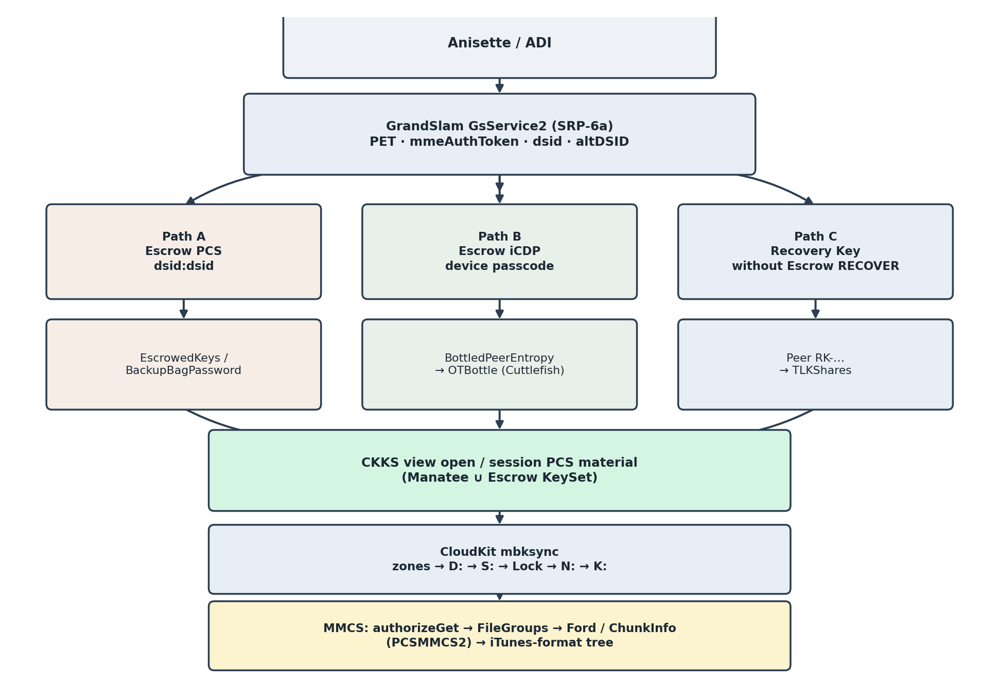

**Figure 1.** End-to-end panorama: Anisette → GrandSlam → three recovery paths → PCS material → `mbksync` → MMCS → iTunes-formatted tree.

---

## 4. Precondition: Anisette / ADI

Before GsService2, the client presents **Anisette** headers of the family `X-Apple-I-MD*`, derived from an ADI (`akd` / provisioning) stack consistent with the declared device profile. Anisette alone does not open a backup: it is the **protocol identity** without which Apple rejects or degrades non-browser clients.

### 4.1 MidService machine provisioning

On real iPhone/`akd` traffic, Anisette material is minted through GrandSlam **MidService** *before* usable `X-Apple-I-MD` / `X-Apple-I-MD-M` headers exist [22]. The reconstructed order is:

```
lookup (url bag)
  → startMachineProvisioning  → spim
  → [local] ADIProvisioningStart(spim, dsId=-2) → cpim + session
  → finishMachineProvisioning(cpim) → ptm, tk, X-Apple-I-MD-RINFO
  → [local] ADIProvisioningEnd(ptm, tk)
  → [local] ADIOTPRequest → X-Apple-I-MD (OTP) + X-Apple-I-MD-M (machine id)
```

Url-bag keys include `midStartProvisioning`, `midFinishProvisioning`, and optional `syncMachine`. Observed routing values after finish include RINFO `17106176` (iOS/`akd`) and `84215040` (Windows AuthKit). Real iPhone `startMachineProvisioning` also carries **`X-Apple-I-SRL-NO`** (hardware serial); stacks that claim an `akd` identity while omitting that class of binding are not equivalent to device provisioning [22].

After provisioning, **`X-Apple-I-MD-M` is stable** (machine identifier); **`X-Apple-I-MD` rotates** on each `ADIOTPRequest` (on the order of ~30 s). Soft reuse of MD material without reminting remains short — on Day-11 evidence, on the order of ~3 minutes of Client-Time [19]. Reminting mid-SRP breaks the init/complete pair.

### 4.2 Identity consistency (hybrid vs end-to-end `akd`)

`MD-M`, `MD-LU`, CPD, and HTTP client-info must belong to the **same provisioned identity**. A concrete failure mode: `authMode: iphone` (akd CPD / headers) paired with a Mac/Xcode-provisioned `MD-M` (e.g. dadoum Docker) — GsService2 **init may succeed**, while **complete returns `ec=-22410`** [23]. That is identity mismatch, not a bridge transport bug.

Operationally, two workable classes appear in the laboratory [23]:

- **Hybrid** — AuthKitWin SRP/2FA with local CoreADI; remote Anisette may supply iPhone-shaped headers for post-login / `ckAppInit` only.
- **End-to-end `akd`** — MidService provisioning, ADI, and CPD must share one iPhone/`akd` identity (Frida on controlled `akd`, or an Anisette server that actually provisions as `akd`, not as Mac/Xcode).

---

## 5. GrandSlam / GsService2 (SRP-6a)

### 5.1 Role in the chain

**GrandSlam** is Apple's authentication service used by native clients (AuthKit). The reference endpoint is `https://gsa.apple.com/grandslam/GsService2/`. Upon completion of authentication (and any associated MFA steps), the iCloud session typically materializes via `setup.icloud.com` (configurations/init and authenticate).

### 5.2 SRP Mechanism (GSA Mode)

- Variant **SRP-6a**, hash **SHA-256**, group **2048-bit**.
- Two-phase flow: **init** (typical fields `A2k`, Apple ID `u`, `cpd`, `ps: ["s2k", "s2k_fo"]`) and **complete** (`u`, `c`, `M1`, `cpd`). The inclusion of unexpected fields (e.g., `M2` in complete) may result in protocol errors.
- If the server omits the iteration count `i`, the observed captures show the value 20016, adopted as default in the IKE prototype.
- The **CPD** (*client provided data*) block links Anisette to the device context: Client-Time, timezone/locale, MD/MD-M/MD-RINFO/MD-LU, Mme-Device-Id, bootstrap / `svct=iCloud`. Typical constant RINFO values observed: Windows `84215040`, iOS/`akd` `17106176`. The AuthKitWin and `akd` profiles differ in fields such as `capp`.

### 5.3 MFA and PET

After the SRP password, subsequent challenges **HSA2** (trusted devices, SMS, etc.) may follow. For subsequent Escrow paths, the **PET** (`com.apple.gs.idms.pet`) is often essential, serving as a password equivalent in Basic authentication (email + PET) on Escrow iCDP.

### 5.4 Output Artifacts

| Artifact | Downstream Role |
|-----------|----------------|
| PET | Escrow Basic / IDMSA flow-related |
| `mmeAuthToken` | MobileMe-style authentication to CloudKit / Escrow |
| `dsid` | Account identity; SRP secret of the PCS Escrow path |
| `altDSID` / Adsid | HKDF salt for the Recovery Key / related derivations |
| Token CloudKit | `ckAppInit`, sync zone, Cuttlefish |

Without these artifacts, the Escrow/Octagon/MMCS chain is not merely incomplete: it is **absent**.

### 5.5 Temporal flow and messages (reference Section 13.1)

The sequence diagram and the request/response skeletons of GrandSlam are presented in Section 13.1 (Figure 6), reconstructed by `GsaGrandSlamAuthService` / `GsaSrpClient`.

---

## 6. EscrowProxy and Recovery Paths

### 6.1 Nature of the service

**EscrowProxy** exposes operations for Secure Backup / HSM (`get_records` / `GETRECORDS`, `SRP_INIT`, `RECOVER`; in experimental contexts also `ENROLL`). This is a **shared transport**: the meaning of recovery is determined by:

1. **label** of the Escrow record;
2. **SRP secret** used in `SRP_INIT` / `RECOVER`;
3. (for iCDP) presence of OTBottle Contents on the Cuttlefish side after recovery.

The *Apple Platform Security Guide* describes the HSM model, SRP, and the limit of **10 attempts** for Escrow Keychain records [8]. This constraint is consistent with experimental observations on iCDP records and with open-source recovery Escrow analyses [12].

### 6.2 Taxonomy of paths

| Path | Transport | Secret | Octagon/CKKS |
|----------|-----------|---------|--------------|
| **A — PCS Escrow** | EscrowProxy | `dsid:dsid` | No |
| **B — iCDP** | EscrowProxy | Device passcode that created the record | Yes (via OTBottle) |
| **C — Recovery Key** | Cuttlefish / CKKS (without `RECOVER`) | Recovery Key → peer `RK-…` | Yes |

| Path | Typical label | Primary output |
|----------|--------------|-----------------|
| **A** | ProtectedCloudStorage / SecureBackup | EscrowedKeys / BackupBagPassword |
| **B** | `com.apple.icdp.record.*` | BottledPeerEntropy (~72 B) |
| **C** | — | fetchRecoverableTLKShares |

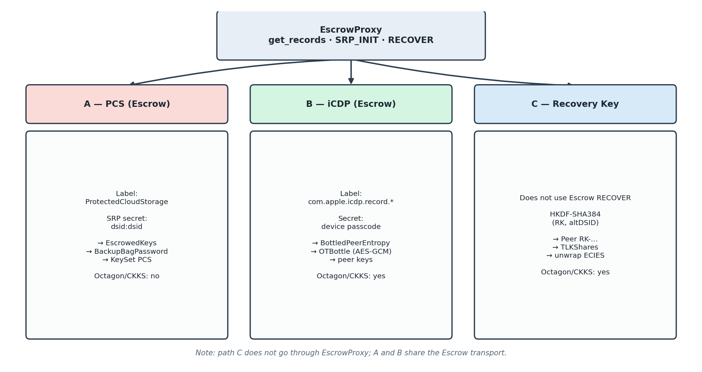

**Figure 2.** EscrowProxy as a shared transport for paths A and B; path C does not use EscrowProxy.

This taxonomy is central: a large portion of integration errors arises from treating the PCS Escrow path as if it provided access to Octagon.

### 6.3 Path A — PCS Escrow (`dsid:dsid`)

The SRP secret can be described as:

```
x = SHA256( salt ‖ SHA256( dsid ‖ ":" ‖ dsid ) )
```

After `RECOVER` is obtained EscrowedKeys; the unwrap produces BackupBagPassword, which is used to open the session's KeySet PCS. This KeySet is sufficient for many backup scenarios without ADP based on Manatee. It does not, alone, provide an Octagon peer identity nor the TLKs of the current CKKS views.

### 6.4 Path B — iCDP (bottle Octagon)

The `com.apple.icdp.record.*` records link Escrow to a device in the Octagon domain (serial number, build, remaining HSM attempts).

- **Listing** (`get_records`): non-destructive — useful for forensic inventory.
- **Recover** with passcode: each incorrect attempt consumes an HSM attempt (10 tries per record, in line with [8]). The IKE prototype requires explicit confirmation.
- The correct passcode is the one in effect **at the time of record creation**, unless subsequently recreated (Sign out → Sign in on the device).
- Output: EscrowBottle opened with **PBKDF2 + AES** → **BottledPeerEntropy** (~72 B) [19].
- Next step: Cuttlefish `fetchViableBottles` → **OTBottle Contents** → AES-GCM → peer keys (signing/encryption) and `peerId`.

**Orphan records:** metadata present, `Contents` absent or zero-length → no peer keys; remain inventory evidence of Escrow–Cuttlefish divergence.

### 6.5 Path C — Recovery Key (without Escrow `RECOVER`)

When the passcode is unavailable (device lost, maximum attempts exhausted, contents missing), the Recovery Key is used:

1. `HKDF-SHA384` with IKM = UTF-8(RK) and salt = UTF-8(altDSID); distinct info strings for *Recovery Signing Private Key* and *Recovery Encryption Private Key*, yielding 56 bytes each [14], [19].
2. Map each 56-byte block to a P-384 private scalar via deterministic reduction `k = (entropy_be mod (q−1)) + 1` (TrustedPeersHelper / Day-11 evidence) [14], [19].
3. Peer ID = `RK-` + Base64(SHA-384 of the signing public key).
4. `ckAppInit` on the container `com.apple.security.keychain`.
5. `fetchRecoverableTLKShares` with `forPeer=RK-…`.
6. Unwrap ECIES of the shares → TLK per view → opening of CKKS views.

An empty `forPeer` field can be used for inventorying encrypted shares; unwrapping is possible only with the destination peer's keys.

### 6.6 Typical Errors and Diagnostics

| Symptom | Typical interpretation |
|---------|------------------------|
| Credentials / M1 wrong (e.g. codes type −6015) | Wrong SRP secret (passcode vs `dsid:dsid` exchanged) |
| CLUBH / version header (e.g., −6122) | Version/header recovery misaligned with the server |
| Listing OK, recover GCM fail | Entropy present but OTBottle contents absent (orphan) |
| Recover succeeds, CKKS views are empty | Peer keys are incompatible with the available TLKShares |
| RK lists share but unwrap=0 | Recovery Key does not match the binding / peer error |

Forensic diagnosis must record **which path** was being attempted: without that context error codes become ambiguous.

### 6.7 Secure Backup Variant with SMS Challenge

A Secure Backup variant oriented to challenge SMS (observed as an experimental option in the IKE prototype) exists. It does not alter the taxonomy: it remains an additional Escrow mechanism on the secret/challenge, not a substitute for Octagon. In this document, it is treated as a marginal note: primary paths in the presence of ADP remain iCDP or Recovery Key.

### 6.8 Temporal flow and messages (reference Section 13.2)

The EscrowProxy sequence diagram (`GETRECORDS` → `SRP_INIT` → `RECOVER`) and the example plist body are presented in **Section 13.2** (Figure 7), reconstructed from `EscrowProxyClient` / `EscrowSrpClient`.

---

## 7. Octagon, Cuttlefish and opening of view CKKS

### 7.1 Octagon

**Octagon** designates the trust domain that connects devices, iCDP records and Recovery Key for ADP, Manatee, and Keychain synchronization [cf. technical discussions on CKKS/Octagon; implementations in [12], [14]]. Without a peer identity capable of opening the relevant views, the Manatee data for ADP-protected backup zones is unavailable—although MMCS continues to serve ciphertext.

### 7.2 Cuttlefish

Service invoked via CloudKit on the container **`com.apple.security.keychain`** (routing cuttlefish). Relevant operations in this context:

- `fetchViableBottles` — bottles and contents OTBottle;
- `fetchRecoverableTLKShares` — Recoverable TLK shares for peer.

### 7.3 Opening of CKKS Views (Steps)

1. Open/synchronize the CKKS views of interest.
2. Identify **`tlkshare`** records; unwrap ECIES using the peer's encryption private key.
3. TLK persistence for view.
4. Unwrapping of **class keys** (`synckey`); decryption of items (`data`) along the CKKS path (AES-SIV / observed variants).
5. SecItem Interpretation (`agrp`, `class`, `v_Data`, …) — particularly relevant for Keychain experiments; for device backup, the PCS/Manatee-derived material takes precedence.

Typically considered in the IKE prototype: `Manatee`, `Engram`, `ProtectedCloudStorage`, `LimitedPeersAllowed`, `Passwords`, `WiFi`.

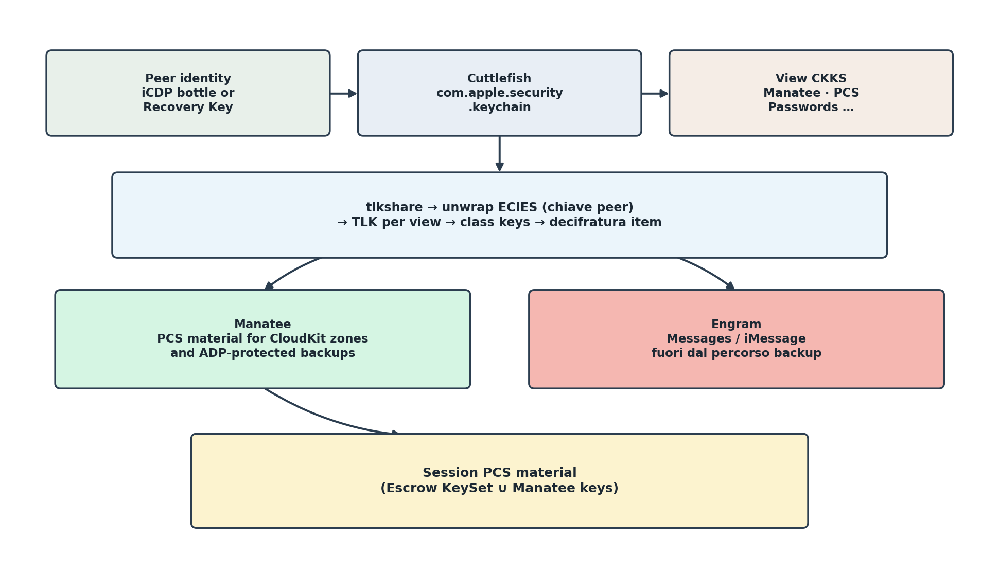

**Figure 3.** From peer identity to PCS material: opening of CKKS views; Manatee feeds the backup via ADP; Engram is excluded from this pathway in the experiments described here.

### 7.4 Temporal flow and messages (reference Section 13.3)

The Cuttlefish/CKKS sequence diagram (Figure 8) and the `ckAppInit` / `fetchRecoverableTLKShares` skeletons are in **Section 13.3**, reconstructed by `OctagonCuttlefishService` and `CkksVaultService`.

---

## 8. Manatee, Engram, TLKShare, and Session PCS Material

| Concept | Description |
|----------|-------------|
| **TLK** | top-level key of a CKKS view |
| **TLKShare** | TLK wrapped ECIES toward a peer |
| **Manatee** | View CKKS observed as primary source of **PCS material** for CloudKit zones / **backup with ADP** |
| **Engram** | Typically associated with Messages/iMessage [6]; not used as a PCS source in device backup experiments |
| **ProtectedCloudStorage** | Family of label/view PCS escrow and vault |
| **Session PCS material** | Controlled union: Escrow KeySet **or** (with ADP) Manatee keys |

**Experimental observation.** The transfer of MMCS chunks with incorrect PCS material results in objects that appear plausible but fail MAC/digest checks. The dominant cause observed was not the network, but rather the **IKM/incorrect PCS material** (Section 10).

---

## 9. CloudKit backup catalog (`mbksync`)

Figure 4 shows the complete sequence from CloudKit inventory to MMCS decryption (Sections 9–10).

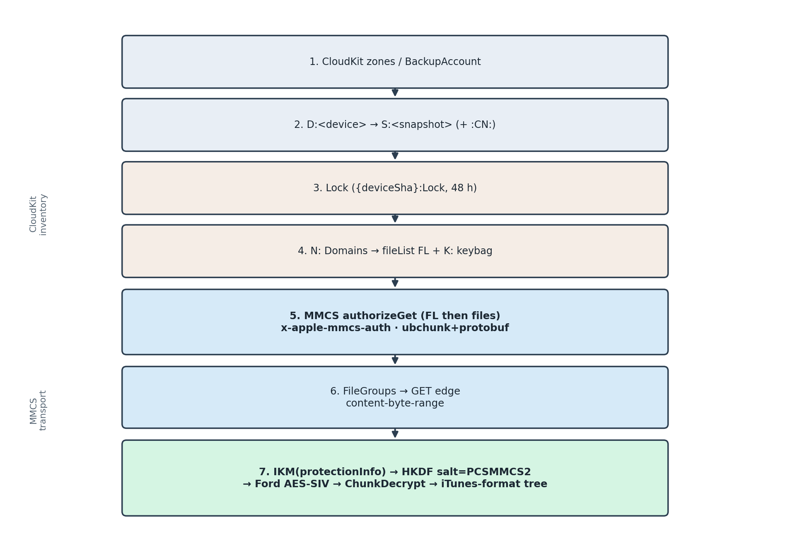

**Figure 4.** Operation order: catalog/`Lock` (CloudKit), then `authorizeGet`/Ford/`PCSMMCS2` (MMCS).

### 9.1 Binding

- Typical container: **`com.apple.backup.ios`**
- Bundle: **`com.apple.backupd`**
- Relevant zones: `_defaultZone`, **`mbksync`**

Some zone/retrieve paths may fall back to the legacy Mobile Backup Service host `{partition}-mobilebackup.icloud.com` (also observed as `p32-mobilebackup.icloud.com`) with `Accept: application/vnd.com.apple.mbs+protobuf` and `X-Apple-MBS-Protocol-Version: 2.2` [19]. That transport is a fallback, not a replacement for the CloudKit `mbksync` catalog when the modern path is available.

### 9.2 Record prefixes and order

Prefixes observed and treated as invariants:

| Prefix / name | Role |
|-----------------|-------|
| `BackupAccount` | Account anchor |
| `D:` | Device |
| `S:` | Snapshot |
| `N:uuid:checksum=:0` | Domain catalog post-Lock (zone `_defaultZone`); holds the `fileList` CKAsset handle — **not** inline paths |
| `K:` | Keybag |
| `FL:{sigHex}` | Client-side synthetic id for a Domain.`fileList` MMCS blob |
| `M:uuid:sig:0` | Classic manifest; field `files` lists `F:` / `KA:` / `MA:` / … |
| `KA:` / `MA:` / `LA:` / `NA:` / `JA:` / … | Asset families (e.g. `MA:udid:uuid:checksumB64:size`) |
| `:CN:` / `CN:` | Contemporary checksum entries on `S:` → drive `N:` record names |

**Terminology note.** Laboratory dumps and some tooling comments write **`EN:`**. On the wire the Domain record name is **`N:…=:0`**. The leading `E` often comes from a protobuf length byte (`0x45` = `'E'`) preceding ASCII `N:`; requesting a literal `EN:` record yields *Record not found* (`CloudKitManifestChecksumParser.ToEnRecordName`) [19].

**Catalog evolution.** Modern path: `S: → :CN: → N:`. Classic path: `S: → M: → files` [19]. Clients that assume only the classic list miss contemporary checksum/Domain records.

**Bootstrap order of restore** (not reorderable without loss of state coherence):

```
zones → BackupAccount → D: → S: → (opt. MBS stub) → Lock → N: → K:
```

### 9.3 Lock

- Typical Lock record: name `{deviceSha}:Lock`, type `Lock`, zone `mbksync`, owner = device SHA (without prefix `D:`), duration **172800** s (48 h) [19].
- Incorrect protobuf wrapping historically produced malformed Lock messages (e.g. size class mismatches); the server failure string is **`Invalid lock id`** (MobileBackupServerExtension) [19].
- Tokens later used by MMCS carry metadata attributable to **Foreground Restore**.

### 9.4 `backupProperties` and keybag

The snapshot field **`backupProperties`** is decrypted as ShareProtection → **CUWK** with label `backupProperties` → **PCSFP-GCM** with AAD type0 = field name [19]. Without session PCS material it remains unreadable. In plaintext it feeds Lockdown.* fields (UDID / model / serial) and sidecars (`Info.plist` / `Manifest.plist`).

The keybag (`K:`) opens with PCS material (contemporary DER bag or classic TLV; AES-KW where applicable). Only an open keybag **and** Lock enable a semantically complete MMCS download.

### 9.5 File lists: Domain retrieve, FL download, SQLite inventory

After Lock, the restore does **not** yet know Backup file paths. Paths live inside per-domain **file-list blobs** referenced from CloudKit **Domain** records. There are two nested meanings of “file list”:

1. **Domain catalog (`N:`)** — CloudKit metadata + an MMCS handle (`fileList` CKAsset).
2. **Decrypted SQLite flist (`flist_*.db`)** — the real inventory (`Assets` ⋈ `FileMetadata`) that drives per-file `authorizeGet`.

#### 9.5.1 From `:CN:` to Domain `N:`

Modern snapshots expose `manifestChecksums` entries of the form `:CN:uuid:checksum`. Each entry maps to a Domain record name [19]:

```
N:{FILE_UUID}:{checksumBase64}=:0
```

in zone **`_defaultZone`**. The client batches `record/retrieve` on those names (`BackupEnRecordService` / `DomainFileListParser`). Classic snapshots instead resolve `manifestIDs` → `M:…:0` and read an inline `files` field; the modern download path stays on `:CN:` / `N:` when both eras coexist.

#### 9.5.2 Domain record fields

A Domain record is a per-domain catalog. Observed fields include:

| Field | Role |
|-------|------|
| `domainName` / `domain` | Domain identity (`domain` may be PCS-encrypted on the wire) |
| `version` | Domain version |
| `cumulativeFileCount` / `Directory` / `Asset` / `EmptyFile` / `SymLink` | Counts |
| `fileListEncoding` | **`2`** = after MMCS (+ optional LZFSE) the blob is **SQLite** (`SQLite format 3`), not protobuf |
| `fileList` | CKAsset / MMCS descriptor (signature, size, auth, ContentBaseUrl, protection wrap) |
| `newAssets` / `deletedAssets` | Optional asset-name deltas |

Optional PCS field decrypt (`DomainPcsFieldDecryptor`) uses zone/record ShareProtection and **PCS GCM** (`PcsGcmDataA`) with AAD = UTF-8 field name. On many modern captures `fileList` is already a plaintext CKAsset handle; brute PCS over that field is skipped when the MMCS auth is already present.

The MMCS descriptor extracted from `fileList` yields a synthetic client asset `FL:{signatureHex}` with `x-apple-mmcs-auth` of the form `{sig21hex} {token17hex} {CAog…}` (`DomainFileListParser.FileListAsset`).

#### 9.5.3 Download and decrypt the FL blob

Each Domain.`fileList` is downloaded with the same MMCS pipeline as backup files (Section 10):

```
x-apple-mmcs-auth(FL) → authorizeGet → FileGroups → content-byte-range
  → IKM from contents.protectionInfo (NISTKDF "wrapping key wrap me" + AES-KW)
  → Ford / PCSMMCS2 (or MMCS-CFB when applicable)
  → optional LZFSE (magic bvx*) → SQLite format 3
```

The decrypted database is materialized as `flist_{sig}.db`. **`fileListEncoding = 2`** is the invariant that the expanded payload is SQLite (`Assets` / `FileMetadata`), not a protobuf inventory [19].

#### 9.5.4 Reading the SQLite inventory

`FileListSqliteParser` joins:

```sql
SELECT a.recordIDSuffix, a.encryptionKey, a.assetSignature, a.assetSize, …
       f.relativePath, f.size, f.mode, f.protectionClass, f.modified, f.birth, …
FROM Assets a
JOIN FileMetadata f ON a.inode = f.inode
```

| Column / derived field | Use downstream |
|------------------------|----------------|
| `recordIDSuffix` | CloudKit / MMCS rid (`uuid:token=:size`) → `F:…` / PrivilegedBatch seed |
| `assetSignature` (21 B) | authorizeGet **f1** |
| `encryptionKey` | per-file class-key / AES material — **not** Ford IKM |
| `relativePath`, `mode`, `protectionClass`, times, uid/gid | inventory / Manifest sidecars |
| `fileID` | `SHA1(domain + "-" + relativePath)` for the iTunes `Backup/` tree |

Directories, symlinks, empty-file stubs, missing 21-B signatures, and zero-size rows are skipped by the download planner (`FlistDownloadPlanBuilder`). A full inventory join (including directories) feeds `ManifestFromFileListBuilder` when rebuilding `Manifest.db` from flists.

#### 9.5.5 From flist rows to Backup files

For each Domain, the interleaved restore does:

1. Download / decrypt / parse that Domain’s FL.
2. Build a batch of `BackupAsset` rows from the SQLite join.
3. Ensure `x-apple-mmcs-auth` per file (often via PrivilegedBatch / PreAuth join on `A:` / `KA:` / `MA:` when the flist row has no auth).
4. Batch `authorizeGet` (typically ≤ 12 files) with **f1** = `assetSignature`, **f2** = CAog, **f4** = companion token [24].
5. Edge GET → Ford/`PCSMMCS2` (or MMCS-CFB) → write `Backup/{fileID[0..2]}/{fileID}`.
6. Keep a **per-domain** MMCS assembly session (Section 10.5).

Only after flists are expanded does the client know which MMCS objects belong in the Backup tree. Counting Domain records or raw CloudKit assets is **not** a substitute for the flist inventory.

### 9.6 Temporal flow and messages (reference Sections 13.4–13.6)

The CloudKit inventory sequence (Figure 9) and the dedicated file-list sequence (Figure 11) are in **Sections 13.4 and 13.6**, reconstructed from `CloudKitAssetService`, `BackupEnRecordService`, `DomainFileListParser`, `FileListSqliteParser`, and `BackupDownloadService`.

---

## 10. MMCS: authorizeGet, FileGroups, Ford and PCSMMCS2

### 10.1 Role

**MMCS** (*MobileMe Cloud Storage*, historical nomenclature persisting in the protocol) delivers the bytes of assets; CloudKit maintains the inventory. The critical conversation is:

```
x-apple-mmcs-auth  →  POST {contentHost}/{dsid}/authorizeGet
  MIME: application/vnd.com.apple.me.ubchunk+protobuf
  → FileGroups (host template + ChunkInfo + assembly refs)
  → GET edge ?content-byte-range=start-end
```

Typical hosts: `{partition}-content.icloud.com` or ContentBaseUrl per-record. The use of `authorizeGet` and chunking toward third-party storage has already been documented in the 2013 disclosures [4], [5]; this work updates the association with the CloudKit catalog `mbksync` and the derivation `PCSMMCS2`.

### 10.2 Header `x-apple-mmcs-auth`

Observed outer shape: `{hex21} {hex21} {CAog…}` (base64url blob with Foreground Restore marker) [19]. In the authorizeGet ubchunk **per-file** entry, field roles are [24]:

| Field | Role |
|-------|------|
| **f1** | Assets `assetSignature` verbatim (21 B, typically `0x04‖20B`) |
| **f2** | `CAog…` token string |
| **f4** | Companion typically `0x01‖20B` |

Batch-header rebuild from entry[0] uses `hex(f1) + hex(f4) + ascii(f2)`. Using a CloudKit mmcs-auth fragment as **f1** yields plans that look authorized and then fail at the edge [19], [24].

### 10.3 FileGroups and the dual nature of the object

Each FileGroup maps to a GET host and contains nested ChunkInfo (checksums of 21 or 45 B, `chunkEncryptionKey`, `ctLen`, offset, assembly references). **The same edge object** may expose:

- **Ford** material (keys) at offset 0 — terminology already present in [6];
- **ChunkInfo** data at other ranges.

Confusion between the two yields MAC failures that look like partial success. Day-11 evidence further bounds Ford `ctLen` (practical window starting at `0x12`) and describes data-ChunkInfo staging (header length `0x28`; LE u64 at `hdr[0x20]` = wire data length; MAC over the trailing 20 bytes of the 21-B checksum) [19].

### 10.4 IKM and Ford KDF (`PCSMMCS2`)

The IKM is **not** the file-list `EncryptionKey`. On owned CloudKit records it is obtained by unwrapping `contents.protectionInfo` with the zone master via **AES-KW** after **NISTKDF** with label **`wrapping key wrap me`** [19], [25]:

```
IKM = AES-KW( NISTKDF(zoneMaster, "wrapping key wrap me"), protectionInfoWrap )
```

Then:

```
HKDF-SHA256(
  ikm  = fileKey,       // from protectionInfo unwrap
  salt = "PCSMMCS2",
  info = "",
  len  = 64             // 0x40
)
```

Typical Ford layout: `lead(1) ‖ nonce(16) ‖ body`, with body = `tag(16) ‖ ciphertext` at offset `0x11`. Decryption uses **AES-SIV (RFC 5297)** with AD `[nonce, lead]`. Per-chunk expansion uses HKDF info `signature-key` (0x60 B → k1/k2/k3).

### 10.5 Classifiers, cache, and per-domain sessions

- Lead `0x04` typical for Ford ciphertext at offset 0.
- Valid data chunks may begin with **`0xC4`** (and other leads ≠ `0x04`); treating them as invalid Ford was a classification error that blocked otherwise complete downloads.
- Ownership descriptors of 45 B with prefix `0C 0F 01 04` ≠ data checksums of 21 B.
- Local cache keyed by hex signature; do not store Ford blobs without IKM (cache corruption).
- Stable fill order: authorizeGet → FileGroups → ranged GET → open Ford → fill chunks → ChunkDecrypt with VerifyDigest.
- **Per-domain isolation:** domains may run in parallel, but each keeps its own assembly / FileGroup cache shard — sharing one assembly session across domains is an anti-pattern (Section 10.7) [19].

### 10.6 Incomplete plans and batch pre-authorization

An authorized GET plan is **incomplete** (and must be treated as a failure) if URL chunks, edge signatures, or the sum of byte ranges is less than the declared size. Estimating missing ranges is the fastest path to cache corruption.

At the upper level, the client organizes batch pre-authorization waves: it prepares signatures and tokens for multiple assets, refreshes Anisette if the edge rejects the identity, and only then issues an authorizeGet. Scalability (thousands of files) does not alter the semantics: each FileGroup remains a local contract among signature, range, and decryption stages.

### 10.7 Anti-pattern MMCS

1. Use the EncryptionKey from the file list as IKM Ford.
2. Store in cache every blob with lead `0x04` without opening it with IKM.
3. Treat 45 B descriptors as 21 B data checksums.
4. Reverse the filling order (decrypt the data before opening Ford).
5. Share a single assembly session among FileGroups from different domains.
6. Reconstruct `x-apple-mmcs-auth` by swapping the signature/token fields.

Each anti-pattern was observed as a silent failure or as a misleading partial success during the 2026 experiments.

### 10.8 Temporal flow and messages (reference Section 13.5)

The UML detail of `authorizeGet` and of GET `content-byte-range` (Figure 10), including headers and MIME, is in **Section 13.5**, reconstructed by `BackupDownloadService` / `UbChunkBuilder`.

---

## 11. Forensic Materialization and Verification

Output objective: an **iTunes-compatible tree** [19]:

- hashed path `Backup/{fileID[0..2]}/{fileID}` with `fileID` = SHA1 hex of the content blob as laid out by the restore;
- Manifest rows keyed consistently with `SHA1(domain + "-" + relativePath)` where applicable;
- `Manifest.db` from decrypted `MA:` (and related) candidates;
- sidecars `Info.plist`, `Status.plist`, `Manifest.plist` (preferably aligned with plaintext `backupProperties`);
- optional tree nesting `{root}/{udid}/[{snapshotGuid}][{timestamp}]/`.

Forensic verification does not stop at download completion: it includes file counts, digests, comparison with the `N:`/`EN:` inventory, and awareness of **orphans** (catalog name, no MMCS asset) and of payloads that are **not** Ford/MMCS crypto (e.g. some third-party model files observed in lab captures) [19]. Domains must keep separate MMCS assembly state (Section 10.5).

---

## 12. Synthesis of pathways, operational risks, and limitations

### 12.1 Three paths → PCS material

| Path | Input | Output toward backup |
|----------|----------|---------------------|
| **A — PCS Escrow** | Escrow `dsid:dsid` | EscrowedKeys / BackupBagPassword → KeySet |
| **B — iCDP** | Escrow passcode + OTBottle | Peer → view CKKS → Manatee/PCS |
| **C — Recovery Key** | HKDF RK + TLKShares | TLK → view CKKS → Manatee/PCS |

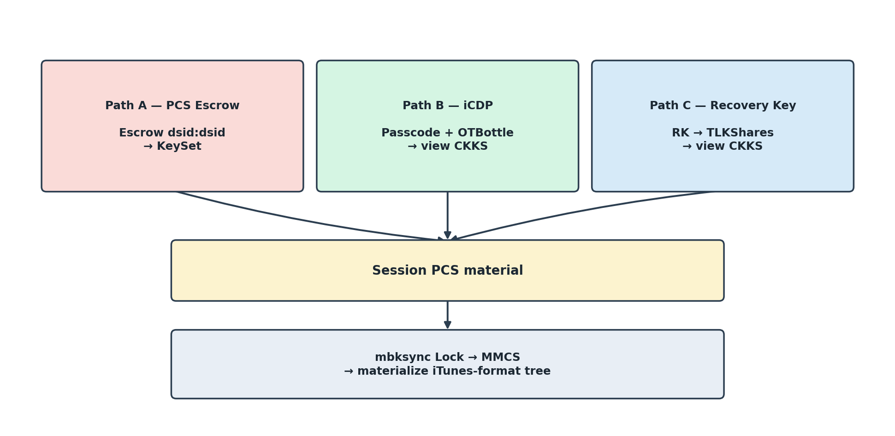

**Figure 5.** A/B/C convergence on the PCS material, followed by the `mbksync`/MMCS sequence.

With ADP enabled, either B or C are typically required; A alone is often insufficient.

### 12.2 Operational Risks

1. Anisette remint mid-SRP, or MidService/`MD-M` identity mismatch vs CPD (`ec=-22410` on complete) [23].
2. Confusion between web PET / idmsa sessions and native AuthKit sessions.
3. Brute force against HSM attempt limits on Escrow records.
4. Current credentials applied to records created under previous credentials.
5. IKM taken from the file-list EncryptionKey instead of `protectionInfo` unwrap (NISTKDF / AES-KW).
6. Ford/ChunkInfo cache corruption; shared assembly across domains.
7. Expired tokens after prolonged Escrow operations (refresh required).
8. Treating ADP failure as “old iOS only”: laboratory captures showed commercial clients able to talk to recent backup eras yet still receiving **HTTP 403** when ADP gated the crypto path [19].

### 12.3 Declared Limits

- Apple's private surfaces do not constitute a stable contract.
- Not every historical file is recoverable (orphans, non-MMCS payloads, third-party encryption).
- Emulated Anisette is not indefinitely usable; Mac-provisioned identity ≠ `akd` identity.
- Opening Keychain via CKKS in the IKE prototype is an experimental path, not a complete Keychain product.
- This document does not cover services outside the defined scope (Section 1.3).

---

## 13. Temporal UML Flows and Protocol Messages

This section consolidates the **sequence diagrams** (UML style) and the **message skeletons** reconstructed from the independent IKE implementation (`src/iCloudKitExtractor.Core`). Sensitive values are replaced with placeholders `<REDACTED>`; field structures, endpoints, and call orders match the cited code.

**Conventions:** Blue arrows = client→server requests; green arrows = responses; beige boxes = local processing. Host `pXX-` = iCloud session partition.

### 13.1 GrandSlam / GsService2

**Prelude (MidService).** Before GsService2 init/complete, real `akd` clients run MidService provisioning (`lookup` → `startMachineProvisioning` / `spim` → `finishMachineProvisioning` / `ptm` / `tk`) as in Section 4.1 and [22] (`AdiProvisioningService`).

**Sources:** `Services/Auth/GsaGrandSlamAuthService.cs`, `GsaSrpClient.cs`, `GrandSlamCpdBuilder.cs`, `AdiProvisioningService.cs`.

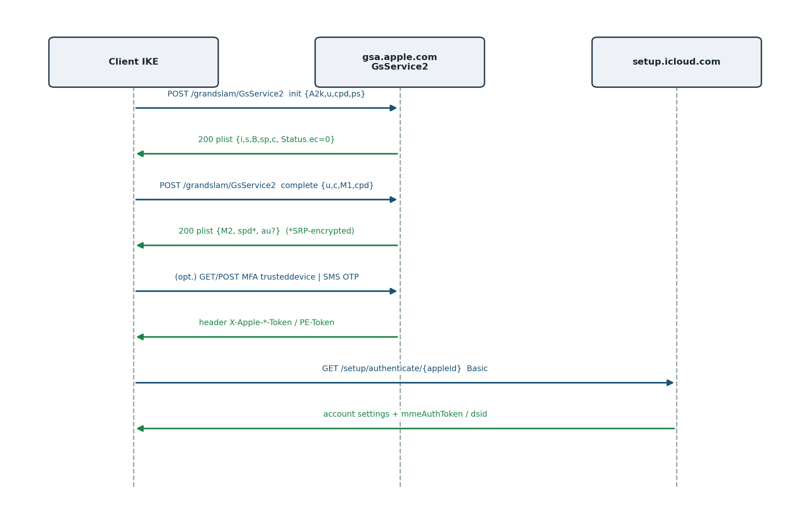

**Figure 6.** GrandSlam Sequence: init/complete SRP, optional MFA, session materialization on `setup.icloud.com`.

**Request — GsService2 init** (`POST https://gsa.apple.com/grandslam/GsService2`, `Content-Type: text/x-xml-plist`):

```xml
<!-- scheletro; Header/Request wrappati da BuildGsService2Request("init", …) -->
<dict>
  <key>A2k</key> <data><!-- SRP public A, 256 B --></data>
  <key>u</key>   <string>user@example.com</string>
  <key>cpd</key> <dict>
    <!-- Client-Time, X-Apple-I-MD*, Mme-Device-Id, bootstrap, svct=iCloud, … -->
  </dict>
  <key>ps</key>  <array><string>s2k</string><string>s2k_fo</string></array>
</dict>
```

Typical headers (beyond Anisette `X-Apple-I-MD*`): AuthKit iPhone or AuthKit Windows profile.

**Response — init** (ec=0):

```xml
<dict>
  <key>Status</key> <dict><key>ec</key><integer>0</integer></dict>
  <key>i</key>  <integer>20016</integer>   <!-- iterazioni; default IKE se assente -->
  <key>s</key>  <data><!-- salt --></data>
  <key>B</key>  <data><!-- SRP public B --></data>
  <key>sp</key> <string>s2k</string>
  <key>c</key>  <string><!-- challenge --></string>
</dict>
```

**Request — complete** (same CPD as init; **do not** send `M2` in the body):

```xml
<dict>
  <key>u</key>  <string>user@example.com</string>
  <key>c</key>  <string><!-- challenge da init --></string>
  <key>M1</key> <data><!-- prova client SRP --></data>
  <key>cpd</key><dict><!-- identico a init --></dict>
</dict>
```

**Response — complete:** `M2` (server verification), `spd` (encrypted SRP blob → adsid, GsIdmsToken, `com.apple.gs.idms.pet`, …), optional `au=trustedDeviceSecondaryAuth`.

**Typical post-login request:** `GET https://setup.icloud.com/setup/authenticate/{appleId}` with Basic → `dsid`, `mmeAuthToken`, partition URL.

---

### 13.2 EscrowProxy (`GETRECORDS` → `SRP_INIT` → `RECOVER`)

**Sources:** `Services/Escrow/EscrowProxyClient.cs`, `EscrowSrpClient.cs`, `EscrowRecoveryService.cs`.

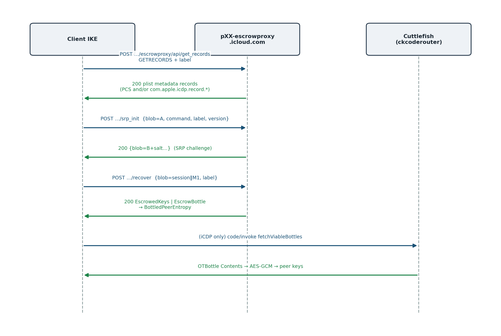

**Figure 7.** EscrowProxy sequence and, for iCDP, transition to Cuttlefish `fetchViableBottles`.

**Endpoint:** `POST https://{partition}-escrowproxy.icloud.com/escrowproxy/api/{get_records|srp_init|recover}`.

**Authentication:**

| Path | Authorization | Content-Type |
|----------|---------------|--------------|
| PCS Escrow | `X-MobileMe-AuthToken` + Basic(`dsid`, `mmeAuthToken`) | `text/x-xml-plist` |
| iCDP | `Basic` email + PET | `application/x-apple-plist` |

**Request — get_records:**

```xml
<dict>
  <key>command</key> <string>GETRECORDS</string>
  <key>label</key>   <string>com.apple.protectedcloudstorage.record</string>
  <!-- oppure enumerazione label icdp: com.apple.icdp.record.* -->
  <key>version</key> <integer>1</integer>
</dict>
```

**Response — get_records:** plist with metadata (serial, build, remaining attempts, timestamp). No HSM consumption.

**Request — srp_init:**

```xml
<dict>
  <key>blob</key>    <data><!-- A SRP, 1..256 B --></data>
  <key>command</key> <string>SRP_INIT</string>
  <key>label</key>   <string>com.apple.icdp.record.<REDACTED></string>
  <key>version</key> <integer>1</integer>
</dict>
```

**Request — recover:** same fields with `command=RECOVER` and `blob` = session material ‖ `M1`.

**Response — recover (PCS):** material **EscrowedKeys** → unwrap → **BackupBagPassword** → KeySet PCS.

**Response — recover (iCDP):** **EscrowBottle** → **BottledPeerEntropy** (~72 B). Next mandatory step: Cuttlefish `fetchViableBottles` → Contents OTBottle → AES-GCM → peer keys.

---

### 13.3 Octagon / Cuttlefish / CKKS

**Sources:** `OctagonCuttlefishService.cs`, `OctagonRecoveryKeyUnlockService.cs`, `CkksVaultService.cs`.

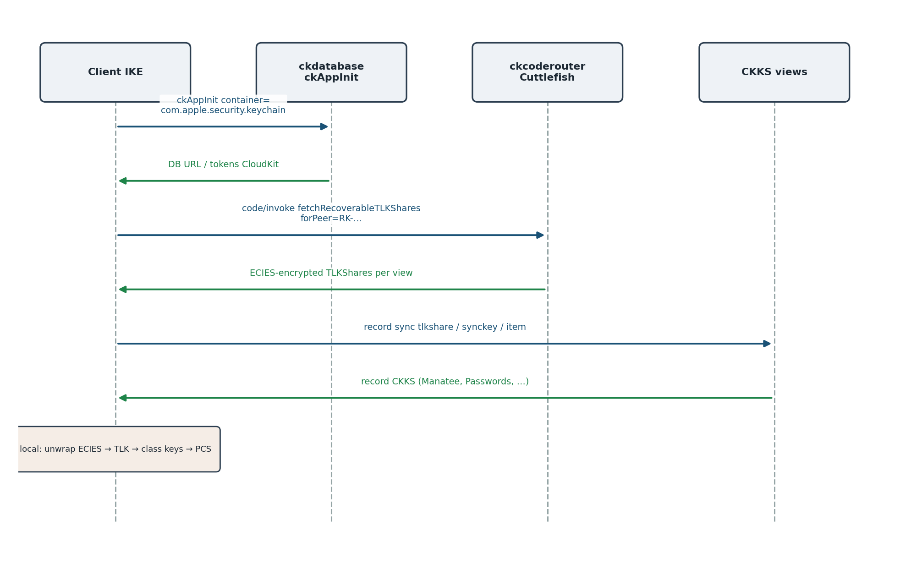

**Figure 8.** Recovery Key / peer → `fetchRecoverableTLKShares` → opening view CKKS.

**Binding:**

- Container: `com.apple.security.keychain`
- Bundle Cuttlefish: `com.apple.security.cuttlefish`
- Gateway DB: `https://{partition}-ckdatabase.icloud.com`
- Invoke: host `*-ckcoderouter.icloud.com`, operation `code/invoke`, service `Cuttlefish`

**Recovery Key steps (local + network):**

1. Local: `HKDF-SHA384(IKM=UTF-8(RK), salt=UTF-8(altDSID), info=Recovery {Signing|Encryption} Private Key)` → P-384 keys.
2. Peer ID = `RK-` + Base64(SHA-384(signing public key)).
3. Network: `ckAppInit` on the Keychain container.
4. Network: `fetchRecoverableTLKShares` with `forPeer=RK-…`.
5. Local: unwrap ECIES of TLKShare → TLK → class keys (`synckey`) → item; extraction of PCS material from Manatee.

**Semantic skeleton of the TLKShare response** (conceptual; protobuf payload CloudKit):

```
functionInvokeResponse:
  recoverableTLKShares[]:
    view  = "Manatee" | "ProtectedCloudStorage" | "Passwords" | …
    wrappedKey = <ECIES blob toward peer RK-…>
```

For the iCDP path, instead of the RK step, `fetchViableBottles` appears after Escrow `RECOVER` (Figure 7).

---

### 13.4 CloudKit `mbksync` (catalog and Lock)

**Sources:** `CloudKitGatewayClient.cs`, `CloudKitAssetService.cs`, `CloudKitLockRequestBuilder`.

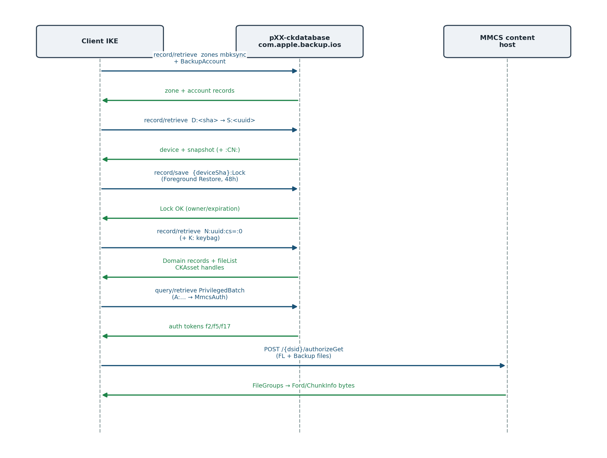

**Figure 9.** Backup inventory sequence: zones → D:/S: → Lock → `N:` Domains → K: → PrivilegedBatch → MMCS (FL and files).

**Binding:**

- Container: `com.apple.backup.ios`
- Bundle: `com.apple.backupd`
- API: `POST https://{partition}-ckdatabase.icloud.com/api/client/{record/retrieve|record/save|query/retrieve|…}`

**Invariant order** (client refuses to reorder):

```
zones → BackupAccount → D:<deviceSha> → S:<snapshotUuid>
  → (opt. MBS stub) → Lock → N:uuid:checksum=:0 → K:
```

**Lock — semantic skeleton** (`record/save`, type `Lock`, zone `mbksync`):

```
recordName = "{deviceSha}:Lock"
owner      = "{deviceSha}"          # without D: prefix
duration   ≈ 172800 s (48 h)
metadata   ⊃ "Foreground Restore"  # later reflected in MMCS tokens (CAog…)
```

**Negative Lock response typical:** string `Invalid lock id` (often due to erroneous protobuf wrapping).

**Domain retrieve (post-Lock):** `record/retrieve` on `N:…=:0` in `_defaultZone` → Domain records with `fileList` CKAsset handles (Section 9.5).

**PrivilegedBatch:** `query/retrieve` on record `A:…` in `_defaultZone` → extracts tokens that compose `x-apple-mmcs-auth` (fields observed as f2/f5/f17) when flist rows lack auth.

---

### 13.5 MMCS `authorizeGet` and edge GET

**Sources:** `BackupDownloadService.cs` (`AuthorizeGetAsync`), `Protocol/UbChunkBuilder.cs`, `FordMmcsDecryptor.cs`.

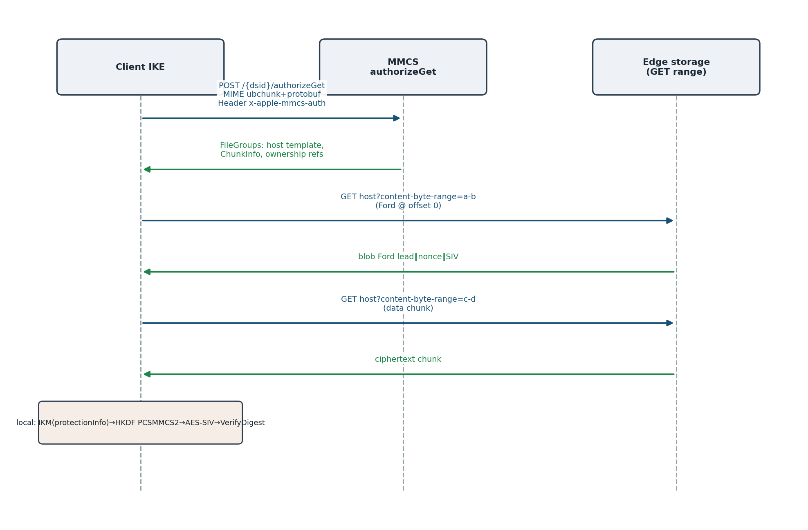

**Figure 10.** MMCS Detail: authorizeGet → FileGroups → ranged GET → local decryption.

**Request authorizeGet:**

```
POST https://{contentHost}/{dsid}/authorizeGet
Content-Type: application/vnd.com.apple.me.ubchunk+protobuf
Accept:       application/vnd.com.apple.me.ubchunk+protobuf
x-apple-mmcs-auth: <tok21hex> <tok21hex> <blobBase64url>
x-apple-mme-dsid: <dsid>
x-apple-mmcs-proto-version: 4.0
x-apple-mmcs-dataclass: com.apple.Dataclass.CloudKit
X-CloudKit-Container: com.apple.backup.ios
X-CloudKit-Zones: _defaultZone | mbksync
```

Body: protobuf ubchunk constructed by `UbChunkBuilder.BuildAuthorizeGetRequest` (typical batch ≤ 12 files).

**Response:** FileGroups with host template, ChunkInfo (checksum 21/45 B, `chunkEncryptionKey`, `ctLen`, offset) and assembly references.

**Edge GET:**

```
GET https://{edgeHost}/…?content-byte-range={start}-{end}
```

Same object: range including offset 0 → **Ford** material; other ranges → data chunks.

**Local decryption (not network):**

```
IKM = unwrap(contents.protectionInfo, zoneMaster)
OKM = HKDF-SHA256(ikm=IKM, salt="PCSMMCS2", info="", len=64)
Ford = AES-SIV(OKM, AD=[nonce, lead])
chunk = ChunkDecrypt(…) + VerifyDigest
```

---

### 13.6 File lists (Domain `N:` → FL → SQLite → files)

**Sources:** `BackupEnRecordService.cs`, `DomainFileListParser.cs`, `DomainPcsFieldDecryptor.cs`, `FileListSqliteParser.cs`, `FlistDownloadPlanBuilder.cs`, `BackupDownloadService.cs` (`ProcessOneDomainAsync` / `MaterializeFileListDbAsync`).

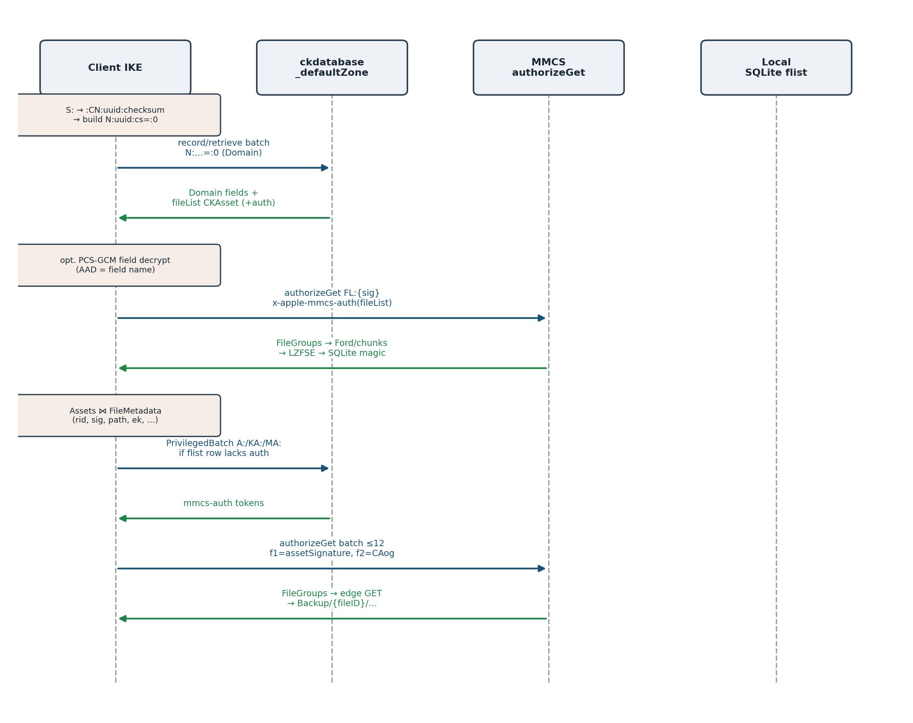

**Figure 11.** File-list path: `:CN:` → `N:` Domain retrieve → MMCS download of `fileList` → LZFSE/SQLite → per-file `authorizeGet` → Backup tree.

**Semantic skeleton — Domain `fileList` CKAsset (conceptual):**

```
recordName = "N:{uuid}:{checksum}=:0"     # _defaultZone; NOT "EN:…"
fields:
  domainName / domain
  fileListEncoding = 2                    # SQLite after expand
  fileList = CKAsset {
    signature21, size, contentBaseUrl,
    mmcsAuth = "{sigHex} {tok17Hex} {CAog…}",
    protectionWrap?
  }
```

**Local expand (after Ford/`PCSMMCS2`):**

```
FL bytes → [LZFSE if bvx*] → "SQLite format 3"
  → Assets ⋈ FileMetadata
  → plan BackupAsset[] (skip dirs/symlinks/empty)
  → ensure mmcs-auth (PrivilegedBatch / PreAuth if needed)
  → authorizeGet batch (f1=assetSignature, f2=CAog, f4=companion)
  → edge GET → decrypt → Backup/{fileID[0..2]}/{fileID}
```

### 13.7 Global synthesis

```
Anisette / MidService
  → GrandSlam init/complete (+ MFA)
  → setup.icloud.com (dsid, mmeAuthToken, partition)
  → Escrow GETRECORDS → SRP_INIT → RECOVER     [and/or RK → TLKShares]
  → (iCDP) fetchViableBottles → peer keys
  → open CKKS views / session PCS
  → mbksync zones → D: → S: → Lock → K:
  → N: Domains (from :CN:) → FL authorizeGet → SQLite flist
  → PrivilegedBatch (MmcsAuth) as needed
  → per-file authorizeGet → FileGroups → content-byte-range
  → Ford / ChunkDecrypt → iTunes-format tree
```

Every arrow admits failure by design; the skeletons of this section are intended for **forensic diagnosis** (which message, which field, which stage).

---

## 14. Conclusions

The recovery of an iCloud backup under PCS/ADP is a **concatenation of protocols**, not a single endpoint. GrandSlam establishes the session; EscrowProxy and Cuttlefish provide semantically distinct recovery paths; Octagon and CKKS (Manatee, TLKShare) supply the material that makes `mbksync` and MMCS usable; Domain **`N:`** / **fileList** records turn Lock into a path inventory (SQLite flists); PCSMMCS2 and the Ford/ChunkInfo discipline transform edge ranges into verified files.

The sequence diagrams and skeletons in Section 13 make the observable messages on the protocol explicit by linking them to the IKE classes that implement them.

For university instruction and forensic practice, the value lies in the **explicit description of paths, invariants, and messages**, and in the transparency of the method (Appendix A). The operational result—iTunes tree on authorized accounts—is empirical evidence that the map is sufficient, not proof that Apple will not modify it.

---

## 15. Final Notes

This white paper is deliberately focused on the **device-backup acquisition chain** (GrandSlam → Escrow/Octagon/PCS → `mbksync` → MMCS). It does not exhaust the scope of *iCloudKit Extractor*.

In addition to this path, IKE uses and integrates — as naming and flow control, independently implemented in C# and within the limits specified in `NOTICE.md` [16] — the same sources previously cited in Section 16 to enhance the tool's completeness with respect to other relevant iCloud surfaces in a forensic context:

| Surface | Role in IKE (summary) | Cited references |
|------------|------------------------|----------------------------------|
| **iCloud Keychain (CKKS)** | Opening CKKS views (Passwords, Wi‑Fi, cert/keys, …) after Octagon peer / TLKShare; see §15.1 | [7], [8], [9], [11], [12], [14] |
| **Messages / iMessage in iCloud** | CloudKit / PCS / Engram-related pathways to Messages | [6], [13] |
| **Photos** | CloudKit sync and viewer-oriented materialization | matrix [17]; lab notes [19] |
| **iCloud Drive** | Probe and pull documents | [2] (cloud drive framing); [17], [19] |
| **Voice Memos / Notes / Sync Data** | CloudKit sync zones beyond `mbksync`; Voice Memos in the modern ADP-era flow — see §15.2 | [17], [19]; PCS/Octagon from [11]–[14] |
| **WhatsApp / Mail / others** | Collateral paths documented in the repository | [17], [18] |

### 15.1 Keychain: Wi‑Fi network passwords (early November 2026)

Along the CKKS path already outlined for Manatee / TLKShare, in **early November 2026** the laboratory unlocked and decoded **passwords of Wi‑Fi networks** stored in iCloud Keychain — that is, credentials of networks the device had joined and that were synchronized into the relevant CKKS view (typically `WiFi` / related SecItems). The result is not a separate protocol from Octagon/CKKS: it is an operational consequence of opening the views with a capable peer (iCDP passcode or Recovery Key) and interpreting the resulting items. Passwords and related fields become available for forensic review once the TLK / class-key unwrap succeeds; without that material, the same records remain client-side ciphertext under ADP.

### 15.2 Sync Data: Voice Memos in the modern (ADP) flow

For **Sync Data** surfaces — and **Voice Memos** in particular — practitioner feedback from digital forensic examiners who compared currently available commercial products (including **Magnet AXIOM Cyber**, **Elcomsoft Phone Breaker**, and related offerings) indicates that **IKE is the first tool** they observed able to acquire Voice Memos through the **contemporary CloudKit / PCS sync path**, especially when **ADP is enabled**. Commercial stacks often still rely on older sync assumptions, web-oriented tokens, or restore-on-device workflows that omit or fail this category under ADP. The claim here is framed as **field comparison by practitioners**, not as a formal vendor-by-vendor audit published in a venue paper; it is recorded because it clarifies IKE’s coverage relative to the backup-centric map of this document and motivates keeping Sync Data (Voice Memos, Notes, …) as a first-class surface alongside `mbksync`.

In summary: this document’s map makes the ADP-era remote backup inspectable; disclosure [4]–[7], Keychain documentation [8]–[9], and open-source projects [11]–[14] continue to inform IKE beyond the iTunes tree — including Keychain Wi‑Fi credentials (§15.1) and modern Sync Data / Voice Memos (§15.2) — toward a more complete acquisition on authorized accounts, without claiming product parity with every commercial tool on every category.

---

## 16. References

### Literature review / preprint

[1] J. Geus, J. Ottmann, and F. Freiling, “Systematic Evaluation of Forensic Data Acquisition using Smartphone Local Backup,” *Proceedings of DFRWS USA*, 2023. Preprint: [arXiv:2404.12808](https://arxiv.org/abs/2404.12808).

[2] V. Roussev, A. Barreto, and I. Ahmed, “Forensic Acquisition of Cloud Drives,” in *Advances in Digital Forensics XII*, G. Peterson and S. Shenoi, Eds. Springer, 2016. Preprint: [arXiv:1603.06542](https://arxiv.org/abs/1603.06542).

[3] M. Zinkus, T. M. Jois, and M. Green, “Data Security on Mobile Devices: Current State of the Art, Open Problems, and Proposed Solutions,” 2021. Preprint: [arXiv:2105.12613](https://arxiv.org/abs/2105.12613).

### Industrial disclosures (conferences)

[4] V. Katalov, “Cracking and Analyzing Apple’s iCloud Protocol,” *Hack in the Box Security Conference (HITBSecConf)*, Kuala Lumpur, 2013. PDF: <https://archive.conference.hitb.org/hitbsecconf2013kul/materials/D2T2%20-%20Vladimir%20Katalov%20-%20Cracking%20and%20Analyzing%20Apple's%20iCloud%20Protocol.pdf>.

[5] O. Afonin, “Cracking and Analyzing Apple iCloud Backups, Find My iPhone, Document Storage,” *REcon*, 2013. PDF: <https://www.elcomsoft.fr/presentations/recon_2013.pdf>.

[6] V. Katalov, “Cloudy With a Chance of Messages: Extracting Messages from iCloud,” *HITBSecConf*, Dubai, 2018. PDF: <https://conference.hitb.org/hitbsecconf2018dxb/materials/D1T2%20-%20Cloudy%20With%20a%20Chance%20of%20Messages%20-%20Extracting%20Messages%20from%20iCloud%20-%20Vladimir%20Katalov.pdf>.

[7] V. Katalov, “iCloud Keychain,” *SecTor*, 2017. PDF: <https://archives.sector.ca/presentations17/vladimir-Katalov-iCloud_Keychain-(Katalov).pdf>

### Official documentation and teaching

[8] Apple Inc., “Escrow security for iCloud Keychain,” *Apple Platform Security Guide*. <https://support.apple.com/guide/security/escrow-security-for-icloud-keychain-sec3e341e75d/web>.

[9] Apple Inc., “Secure iCloud Keychain recovery,” *Apple Platform Security Guide*. <https://support.apple.com/guide/security/secure-icloud-keychain-recovery-secdeb202947/web>.

[10] IAIK, Graz University of Technology, “iOS Platform Security” (course slides), 2024. PDF: <https://www.isec.tugraz.at/wp-content/uploads/2023/09/2024-05-03-iOS-Platform-Security.pdf>.

### Software consulted and project artifacts

[11] Laky-64, *appleservices* (MIT) — cross-flow escrow iCDP / OTBottle / CKKS. <https://github.com/Laky-64/appleservices>

[12] Sank6, *iCloud-Keychain-for-Linux* (MIT) — notes on KeyVault / Cuttlefish. <https://github.com/Sank6/iCloud-Keychain-for-Linux>

[13] OpenBubbles, *rustpush* (SSPL) — PCS / Octagon study; not redistributed in IKE. <https://github.com/OpenBubbles/rustpush>

[14] Apple open-source Security / TrustedPeersHelper — KDF Recovery Key / domain separation (Apple OSS)

[15] ElcomSoft, *Elcomsoft Phone Breaker* — experimental observation on licensed builds; not OSS-dependent.

[16] G. Sconti, *NOTICE.md* — attribution and boundaries of independent implementation. <https://github.com/GiordanoSconti/iCloudKitExtractor/blob/main/NOTICE.md>

[17] G. Sconti, “iCloud Acquisition Matrix (Windows),” 8 November 2026. <https://github.com/GiordanoSconti/iCloudKitExtractor/blob/main/docs/COMPARISON_ICLOUD_ACQUISITION.md>.

[18] G. Sconti, *iCloudKit Extractor* (IKE) — repository and README. <https://github.com/GiordanoSconti/iCloudKitExtractor>

[19] G. Sconti, Laboratory experimental notes (Day 1–11) and MMCS/protobuf maps, March–November 2026. <https://giordanosconti.github.io/iCloudKitExtractor/>

[20] G. Sconti, “Themida, x64dbg MCP, and Frida on memcpy,” Experimental Lab note, 5 November 2026. <https://giordanosconti.github.io/iCloudKitExtractor/blog/posts/2026-11-05-themida-x64dbg-mcp-frida-memcpy.html>. Includes a link to the master's thesis used as a map: [Masters Thesis.pdf](https://github.com/67-6f-64/AntiOreans-CodeDevirtualizer/blob/main/Masters%20Thesis.pdf) ([67-6f-64/AntiOreans-CodeDevirtualizer](https://github.com/67-6f-64/AntiOreans-CodeDevirtualizer)).

[21] J. Geus, J. Gruber, J. Wozar, and F. Freiling, “From sync to seizure: A binary instrumentation-based evaluation of the iCloud backup process,” *Forensic Science International: Digital Investigation*, vol. 54, 301978, 2025, doi: [10.1016/j.fsidi.2025.301978](https://doi.org/10.1016/j.fsidi.2025.301978). DFRWS APAC 2025. PDF: <https://dfrws.org/wp-content/uploads/2025/10/From-sync-to-seizure-A-binary-instrumentatio_2025_Forensic-Science-Internat.pdf>.

[22] G. Sconti, “Apple GrandSlam — MidService provisioning (real anisette),” project documentation, 2026. <https://github.com/GiordanoSconti/iCloudKitExtractor/blob/main/docs/APPLE_MIDSERVICE_PROVISIONING.md>.

[23] G. Sconti, “Anisette and auth modes (reference iPhone vs Docker),” project documentation, 2026. <https://github.com/GiordanoSconti/iCloudKitExtractor/blob/main/docs/MAC_ANISETTE.md>.

[24] G. Sconti, “MMCS authorizeGet code map,” Experimental Lab note, 5 November 2026. <https://giordanosconti.github.io/iCloudKitExtractor/blog/posts/2026-11-05-mmcs-authorizeget-code-map.html>.

[25] G. Sconti, “Day 05 — IKM from protectionInfo (not file-list EncryptionKey),” Experimental Lab note, 16 June 2026. <https://giordanosconti.github.io/iCloudKitExtractor/blog/posts/2026-06-16-day-05-ikm.html>.

---

# Appendix A — Reverse Engineering Methodology

This appendix describes **how** the protocol chain was reconstructed. It is an integral part of the whitepaper: without a method, a description of the protocols would remain anecdotal. It does not provide a redistributable software protection evasion procedure; it outlines objectives, tools, chronological phases, and validation criteria.

## A.1 Research question and ethical constraints

**Question.** Which messages, orderings, and cryptographic primitives are necessary and sufficient to acquire an iCloud backup (with and without ADP) on authorized accounts, in a reproducible manner in an independent client?

**Constraints.**

- Account / devices under control or mandate.
- Legitimate license of the commercial client used as **observational reference**.
- No redistribution of modified binaries.
- Persistent output = labeled captures, invariant, and independent implementation (IKE).

## A.2 General Strategy

Three parallel pillars:

1. **Commercial Observational Reference (EPB)** — which network exchanges characterize a successful or failed restore (for example, 403 with ADP)?
2. **Controlled device (jailbroken)** — GrandSlam mobile, Anisette/`akd`, CloudKit names (`com.apple.backup.ios`, `mbksync`) from the perspective of an authentic Apple client.
3. **Independent Client (IKE)** — hypothesis → implementation → comparison with live captures → review when an invariant fails.

Typical cycle: *observe → formulate hypotheses on field/organization → implement → repeat on laboratory account → consolidate only what survives peer review*.

## A.3 Tools

| Tool | Usage |
|-----------|-----|
| **x64dbg** (+ MCP bridge) | Prolonged sessions on protected Windows clients; breakpoints on decode stubs; dumps of post-virtualization/post-mutation regions |
| **Frida (Windows)** | Hook on `memcpy` (CRT VC++) to observe HTTP/plist/protobuf buffers without relying exclusively on TLS pinning violations |
| **Frida (iOS)** | Anisette Identity / `akd` on controlled device |
| **Proxy / custom logging** | Once endpoints and MIME are known, repeatable captures from the IKE client |
| **Note Day 1–11** | Experimental log: facts still valid on the protocol vs. hypotheses discarded |

### A.3.1 Commercial client protection and reference thesis

The commercial Windows client exhibited packing, API wrapping, anti-debugging, virtualization, and instruction mutation. Prior to devising a dedicated pathway, the preliminary study employed as a **conceptual map** (not as an automatic unpacker) the master's thesis on software obfuscation/protection and DBI-oriented recovery, published in conjunction with the *AntiOreans-CodeDevirtualizer* project:

- PDF: [Masters Thesis.pdf](https://github.com/67-6f-64/AntiOreans-CodeDevirtualizer/blob/main/Masters%20Thesis.pdf)
- Repository: [67-6f-64/AntiOreans-CodeDevirtualizer](https://github.com/67-6f-64/AntiOreans-CodeDevirtualizer)

The attached tool code **was not** executed in the laboratory. From the thesis, an operational vocabulary was derived: *write-then-execute* patterns, import reconstruction, PE dumping, distinction between virtualization and mutation. The objective was not to publish an unpacker, but to isolate the regions involving network and cryptography. A dedicated laboratory note is provided in [20].

### A.3.2 Recovery of native windows post-virtualization (Themida-class)

In virtualized environments, the interest logic is not readable as static native code: it is executed by a protector's VM and, at certain points, is **materialized** (even temporarily) as native bytes in memory. The laboratory followed a repeatable cycle, guided by the thesis checklist and x64dbg:

1. **Classify the layer** — packing / API wrapping / anti-debug / VM / mutation — before investing time in the region.
2. **Identify the decode points** — stubs that write to RWX regions or update VM handlers (pattern *write-then-execute* from the thesis).
3. **Stop after transition** — breakpoint on the decode stub / after the handler return; dump of the just-written memory window.
4. **Compare dumps across runs** — retain only the buffers that occur in proximity to network calls or HTTP/plist buffers in subsequent sessions (correlation with Frida, §A.3.3).
5. **Annotate, do not redistribute** — the dumps remain laboratory artifacts; in IKE only the protocol invariant (field, order, KDF) enters, not the reconstructed binary.

**Operational example (abstract).** On a virtualized block that, downstream, fed the construction of an EscrowProxy body:

- MCP on x64dbg set a breakpoint on the VM exit stub;
- at the hit, dump of $N$ KiB from the destination region of the write;
- comparison with the dump from the previous run (same laboratory account, same Escrow flow);
- if the dump contained recognizable strings (`command`, `GETRECORDS`, `ProtectedCloudStorage`, plist prefixes) or fragments of SRP blobs, the region was marked as «protocol-relevant»; otherwise discarded as mutation noise.

In this sense, the observed "decryption seed" is not a publicly releaseable Themida key, but rather the **runtime moment** at which the protector has already generated (in memory) readable instructions or buffers; by capturing that moment, one avoids fighting the entire VM as a black box. The acceleration came from controlling x64dbg via **MCP** with a coding assistant (reproducible dumps, triaging). The judgment "this block reveals an Apple RPC" remained human.

### A.3.3 Frida on `memcpy` (Windows): message and secret PCS `dsid:dsid` capture

Intercepting TLS end-to-end on a protected client proved intrusive (pinning, stack customization, protector wrapper). Instrumenting **`memcpy`** (and related CRT Visual C++ / `ucrtbase`) revealed the body and headers at the moment they existed as ordinary buffers—typically *after* the application had constructed the message and *before* (or alongside) the TLS record.

**Filter schema used in the laboratory** (pseudocode; not a redistributable attack script):

```javascript
// Frida (Windows) — idea: hook memcpy del CRT, filtrare copie «interessanti»
Interceptor.attach(Module.findExportByName("ucrtbase.dll", "memcpy"), {
  onEnter(args) {
    const n = args[2].toInt32();
    if (n < 32 || n > 2_000_000) return;          // scarta rumore
    const src = args[1];
    const head = hexdump(src, { length: Math.min(n, 64), ansi: true });
    // Prefissi utili alle catture Apple:
    //  "POST ", "HTTP/1", "<?xml", "bplist", "command", "SRP_INIT", …
    if (!looksLikeHttpOrPlistOrProtobuf(src, n)) return;
    send({ len: n, preview: head, stack: Thread.backtrace(this.context) });
    // Opzionale: dump completo su file di laboratorio etichettato
  }
});
```

**Concrete example — discovery/confirmation of `dsid:dsid`.** During an Escrow PCS (`label = ProtectedCloudStorage` / SecureBackup) flow, intercepted buffers showed:

1. Body plist of `SRP_INIT` / `RECOVER` with fields `command`, `label`, `blob`, `version`.
2. During the same time interval, copies of UTF-8 strings of the form
`<dsid>:<dsid>`
(same numeric identifier on both sides of the `:`), used as the identity `I` and password `P` for the SRP computation — **not** the device passcode.
3. Correlation with the response `srp_init` (salt `s`, public key `B`): repeated offline

```
inner = SHA256( dsid ‖ ":" ‖ dsid )
x     = SHA256( salt ‖ inner )
```

Produced an `M1` accepted by the server (ec≠−6015). The same experiment with `dsid:passcode` failed on the PCS path and succeeded on the iCDP path—empirical confirmation of the **distinct-port taxonomy** (Section 6).

Other typical details emerged from the same hooks (always on laboratory accounts):

| Observed in `memcpy` | Subsequent use in IKE |
|-----------------------|------------------------|
| Header Anisette `X-Apple-I-MD*` coherent init/complete | `GrandSlamCpdBuilder` |
| PET / Basic `email:PET` toward escrowproxy | auth iCDP |
| `X-MobileMe-AuthToken` + dsid | auth PCS / CloudKit |
| MIME `application/vnd.com.apple.me.ubchunk+protobuf` | `authorizeGet` |
| `CAog…` prefixes / 21-byte MMCS tokens | `x-apple-mmcs-auth` |
| Record names `D:`, `S:`, `{sha}:Lock` | `mbksync` order |

**Frida on iOS** (distinct pillar): script under `scripts/ios_akd_probe/` (`frida_anisette.js`, `frida_anisette_lite.js`, IDS/HTTP captures) for minting Anisette on `akd` and for validating CloudKit names from the authentic Apple client — not for bypassing Windows protection.

## A.4 Timeline of Discoveries (March–October 2026)

### A.4.1 March — ADP, GrandSlam, initial backup candidates

Requirement: backup with ADP. EPB did not fully address the case; GrandSlam proved fragile even from the vendor side (subsequent fix). Parallel paths: idmsa web (tokens inadequate for native clients) and iPhone jailbroken (GrandSlam mobile + `mbksync`).

**Consolidated invariants:** init/complete GsService2 form; CPD Anisette; binding `com.apple.backup.ios` / `mbksync`.

### A.4.2 April — snapshot and Lock

The `D:`/`S:` listing does not constitute a restore. The lock on `mbksync` is a state requirement; Frida and requested/response archived pairs enabled reconstruction of the machine state. The lock was obtained **before** the `backupProperties` decryption could proceed (which required PCS/Octagon materials in October).

**Invariants:** order zones→Account→D:→S:→Lock→N:; Domain `N:…=:0` (not literal `EN:`); Lock shape; duration; errors `Invalid lock id`.

### A.4.3 May–July — MMCS, IKM, Ford vs ChunkInfo

After Lock: edge host, ranged GET, protobuf ubchunk. Critical result: IKM from **`protectionInfo`**, not from the EncryptionKey in the file list. During summer period: cache coherence issues (storing every `0x04` corrupts `.chunks/`). Discipline: Ford only with IKM; fixed fill order.

**Invariants:** MIME/header of authorizeGet; FileGroups; KDF `PCSMMCS2`; AES-SIV Ford; ownership descriptors 45 B vs data checksum 21 B.

### A.4.4 August — `0xC4` and the iTunes tree

Classification error: lead ≠ `0x04` does not imply "Ford invalid". Data chunks with lead `0xC4` triggered download protocol-complete. iTunes layout instantiation (`Manifest.db`, sidecars).

### A.4.5 October — Octagon (passcode, then Recovery Key)

MMCS could transfer ciphertext indefinitely; ADP decided whether to open it. October 5: record iCDP + passcode. October 24: Recovery Key → peer `RK-…` → TLKShares → Manatee. Unified material → `backupProperties` and zones with ADP.

## A.5 Validation Criteria

A fact enters the stable map only if:

1. compare in independent captures / restore live;
2. survives IKE client revisions;
3. has a clear counterexample when violated (e.g., exchanged salt/info HKDF → Ford does not open; `M2` in complete → GSA error).

Lab notes entry for Day 11 explicitly lists these facts. The present white paper revisits the descriptive content in Sections 5–10.

## A.6 What the method does not claim

- Permanent stability of private APIs.
- Completeness for every historical asset.
- Equivalence between observation of EPB and possession of its source code.
- Applicability of the same methodology to unauthorized accounts (it is neither ethically nor legally justified).

## A.7 Educational Transfer

For a university course in security/forensics, the instructional methodology is:

1. separate the observational reference (observed behavior) from the independent implementation (own code);
2. use the literature on obfuscation/DBI (including the thesis in [20]) as a checklist, not as an unpack button;
3. correlate post-virtualization dumps and hook `memcpy` until a protocol invariant emerges (e.g., `dsid:dsid` vs `dsid:passcode`);
4. version control hypotheses in an experimental log;
5. elevate to «protocol» only those invariants that survive counterproofs;
6. document paths and anti-patterns (Sections 6 and 12) regarding cryptographic primitives.

---

# Appendix B — Glossary

| Term | Definition |
|---------|-------------|
| GrandSlam / GSA | Apple ID Authentication via GsService2 + SRP-6a |
| CPD | *Client provided data* (Anisette + device context) |
| PET | Post-login password equivalent token |
| dsid:dsid | SRP secret for the PCS Escrow path |
| EscrowProxy | Shared HSM Secure Backup transport for multiple recovery paths |
| EscrowedKeys / KeySet | PCS material recovered from Escrow |
| BackupBagPassword | Post-SRP artifact to open the KeySet |
| iCDP bottle | Record Escrow `com.apple.icdp.record.*` |
| BottledPeerEntropy | ~72 byte from EscrowBottle |
| OTBottle | Ciphertext Cuttlefish → peer keys |
| Octagon | ADP Trust Domain / Manatee / CKKS |
| Cuttlefish | Invoke service on `com.apple.security.keychain` |
| CKKS | CloudKit Keychain Syncing |
| TLK / TLKShare | CKKS view key and ECIES share key |
| Manatee | View CKKS → PCS material for ADP/backup |
| Engram | View CKKS associated to Messages; outside the backup path described here |
| mbksync | CloudKit zone of the backup catalog |
| Lock | Session restore log on mbksync |
| authorizeGet | FileGroups MMCS Plan Authorization |
| PCSMMCS2 | Salt HKDF for Ford keys |
| Ford | AES-SIV key blobs on edge MMCS (term in [6]) |
| ChunkInfo | Data chunk descriptors (checksum, range, assembly) |
| ADP | Advanced Data Protection |
| Session PCS material | PCS keys available to the client for inventories and MMCS |
